# TabForge 0.7.5

**A keyboard-driven tablature and notation editor for Windows. Opens GP files (.gp3, .gp4, .gp5, .gpx, .gp) and saves .gp and its own .tforge projects.** Write, import and play back guitar, bass, drum and keyboard parts, with a live fretboard / keyboard, an arrangement timeline, audio and MIDI recording, a mixer, VST plug-ins and offline audio and video rendering.

[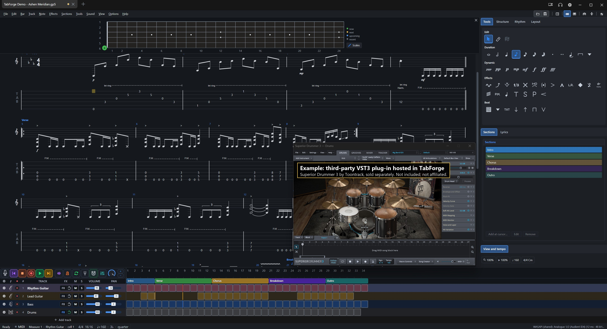](docs/screenshots/github-main.jpg)

*The plug-in shown is a third-party example (Superior Drummer 3 by Toontrack): not included and not affiliated.*

### See it in action

<table>
<tr>
<td width="33%" valign="top"><a href="docs/animations/recording.gif">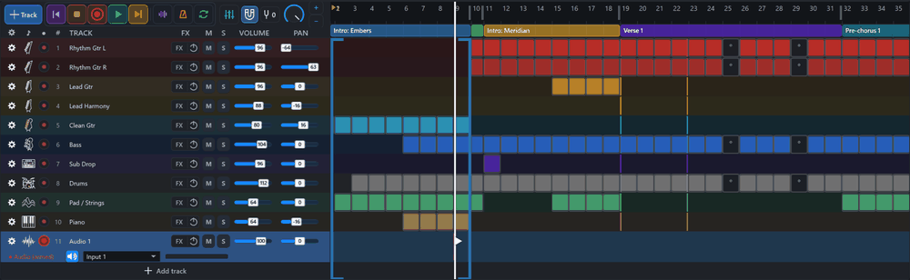</a><br>Recording a take onto a track.</td>
<td width="33%" valign="top"><a href="docs/animations/section-move.gif">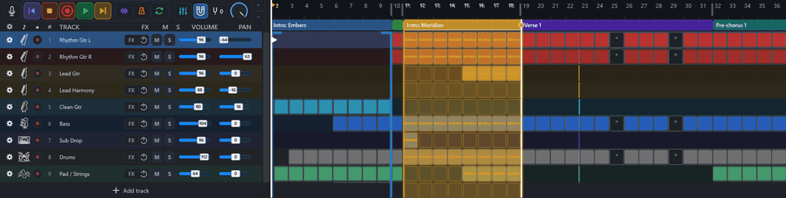</a><br>Moving a section to a new position.</td>
<td width="33%" valign="top"><a href="docs/animations/mixer.gif">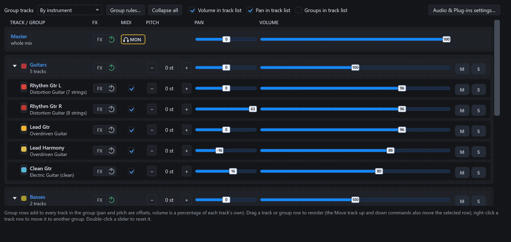</a><br>Adjusting levels in the mixer.</td>
</tr>
</table>

**Contents:** [New in 0.7.5](#new-in-075) · [Download](#download) · [What sets it apart](#what-sets-it-apart) · [Writing tab and notation](#writing-tab-and-notation) · [Instruments on screen](#instruments-on-screen) · [Arrangement and tracks](#arrangement-and-tracks) · [Recording and live input](#recording-and-live-input) · [Playback and practice](#playback-and-practice) · [Band view, Keyboard mode and compact mode](#band-view-keyboard-mode-and-compact-mode) · [Sound](#sound) · [Export](#export) · [Customising](#customising) · [Files, safety and updates](#files-safety-and-updates) · [Full feature reference](#full-feature-reference) · [Verify your download](#verify-your-download) · [Building from source](#building-from-source) · [Licence](#licence)

## New in 0.7.5

A short tour of what changed. Click a picture for the full size.

<table>
<tr>
<td width="33%" valign="top"><a href="docs/screenshots/band-above.png">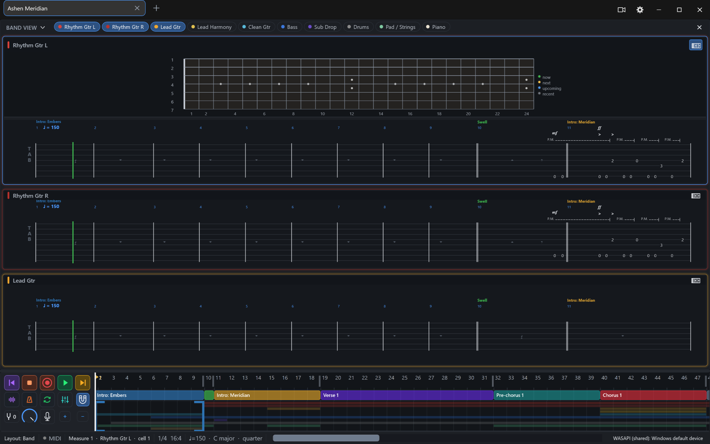</a><br><b>Band view</b><br>One row per track, each framed in its colour. The fretboard now sits above the tab and only the first track shows one; the others show a line of music each. Fretboard beside the tab is in the BAND VIEW menu.</td>
<td width="33%" valign="top"><a href="docs/screenshots/compact-mode.png">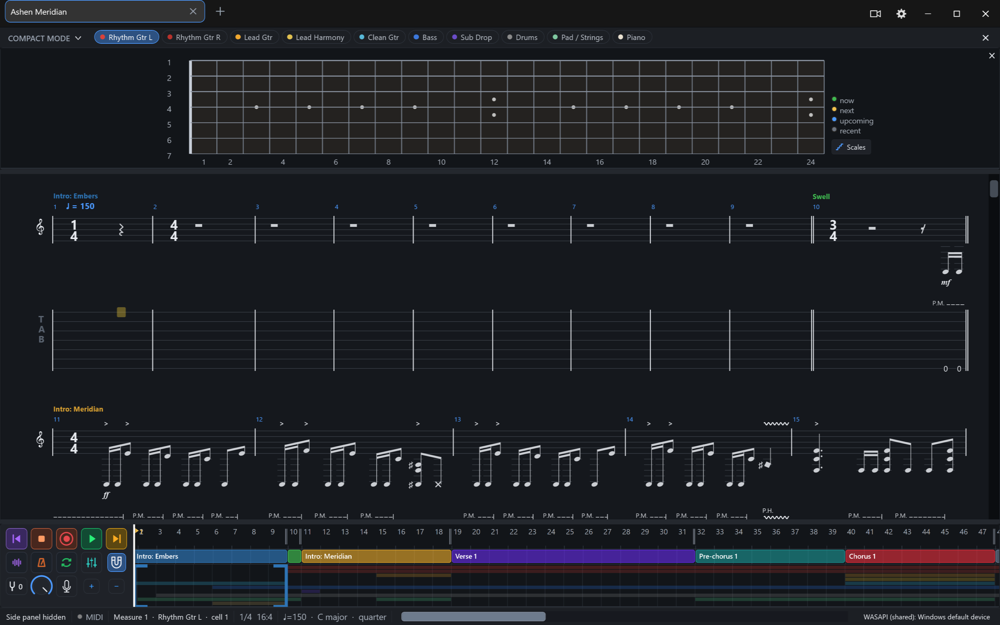</a><br><b>Compact mode</b><br>Hides the track rows and the menu row so the score gets the room. A strip of track capsules switches track, and its menu holds the menus and tools.</td>
<td width="33%" valign="top"><a href="docs/screenshots/live-input.png">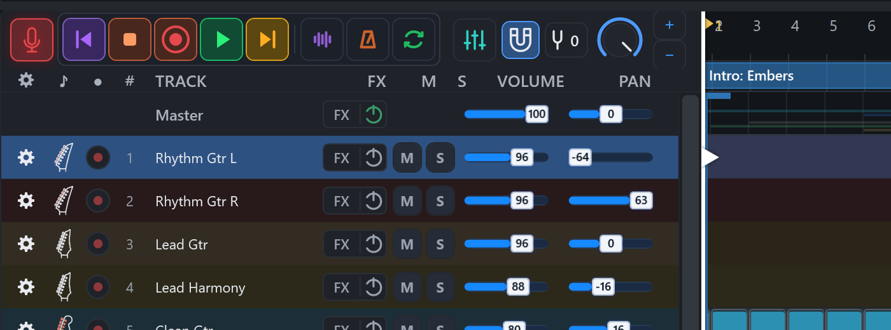</a><br><b>Live input</b><br>The microphone button plays your guitar or a MIDI keyboard through a live FX chain at once: no track, no recording. One for the whole program.</td>
</tr>
<tr>
<td width="33%" valign="top"><a href="docs/screenshots/master-lane.png">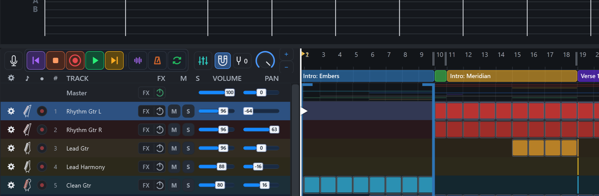</a><br><b>Master track lane</b><br>An overview above the tracks: one thin line per track, filled where that track plays, with the master FX, volume and pan beside it.</td>
<td width="33%" valign="top"><a href="docs/screenshots/icon-row.png">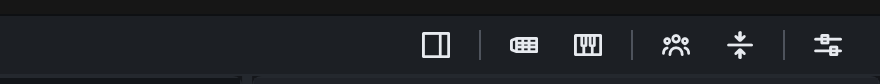</a><br><b>Top bar icons</b><br>Grouped by kind: side panel, fretboard and Keyboard mode, Band view and compact mode, project settings. Drag an icon to reorder; the order is remembered.</td>
<td width="33%" valign="top"><a href="docs/screenshots/zoom-speed.png">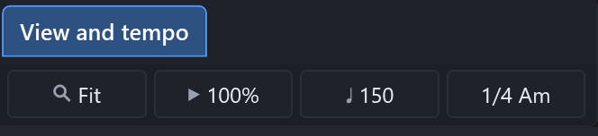</a><br><b>View and tempo</b><br>Zoom, speed, tempo and time / key are one row of four buttons in the side panel: click for presets, right-click to fine-tune.</td>
</tr>
</table>

See the [changelog](CHANGELOG.md) for everything in 0.7.5.

## Download

> [!TIP]
> **[Setup installer](https://github.com/cobhc95/TabForge/releases/download/v0.7.5/TabForge-0.7.5-setup.exe)** · no administrator rights needed
>
> **[Portable ZIP](https://github.com/cobhc95/TabForge/releases/download/v0.7.5/TabForge-0.7.5-win-x64-portable.zip)** · extract and run `TabForge.exe`

Windows 10 or 11, 64-bit, nothing else to install. Not code-signed: see [Verify your download](#verify-your-download). Older versions: [Releases](https://github.com/cobhc95/TabForge/releases).

## What sets it apart

- **One window:** tab editing, audio and MIDI recording, a mixer and VST2 / VST3 plug-ins on the tracks of a tab.
- **Band view and Keyboard mode:** every track on its own instrument following playback, or falling notes with play-along scoring and *Wait for me*.
- **Live input:** one button plays a guitar or MIDI keyboard through an FX chain, with no track and no recording.
- **Video from the score:** export a self-playing MP4, or record the score with the sound you hear.
- **MIDI processing before every plug-in:** arpeggiator, step sequencer, humaniser, drum trigger and more.
- **Yours to arrange:** remappable shortcuts with a command palette, dockable panes, and songs as tabs that move between windows.
- **Plug-in safety:** plug-ins load only once approved and run outside the editor; one that crashes is switched off.

## Writing tab and notation

Type frets with the keyboard; standard notation and tab update together. Click a picture for the full size.

<table>
<tr>
<td width="33%" valign="top"><a href="docs/animations/score-entry.gif">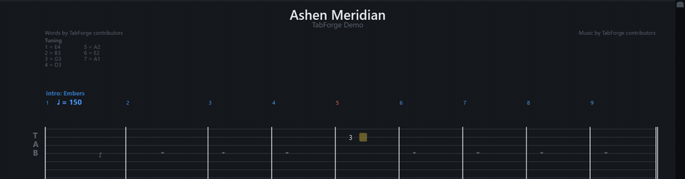</a><br><b>Keyboard entry</b><br>Type frets (two quick digits for 10 and above), move with the arrows, <code>+</code> / <code>-</code> change the length, <code>.</code> adds a dot.</td>
<td width="33%" valign="top"><a href="docs/screenshots/notation-clefs-harmonics.png">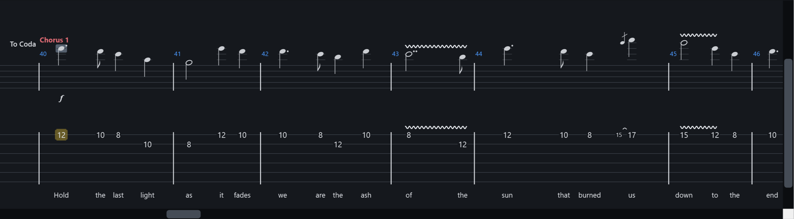</a><br><b>Notation and tab</b><br>Standard notation, tab or both, with the real clef on every system, two voices per bar, tuplets, ties and chord names.</td>
<td width="33%" valign="top"><a href="docs/screenshots/tool-palette.png">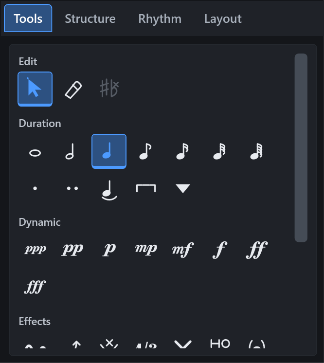</a><br><b>Tool palette</b><br>Durations, dynamics, effects and bar structure in tabbed pages. Right-click a tool to pin it to the quick strip.</td>
</tr>
<tr>
<td width="33%" valign="top"><a href="docs/screenshots/effect-bend.png">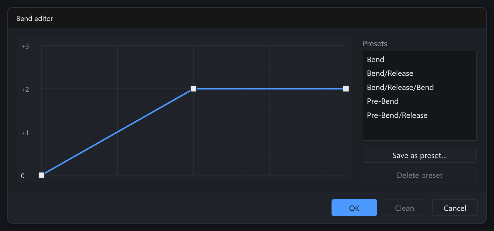</a><br><b>Bend editor</b><br>Draw the bend curve on a grid or pick a preset. It plays back as drawn and applies as one undo step.</td>
<td width="33%" valign="top"><a href="docs/screenshots/effect-tremolobar.png">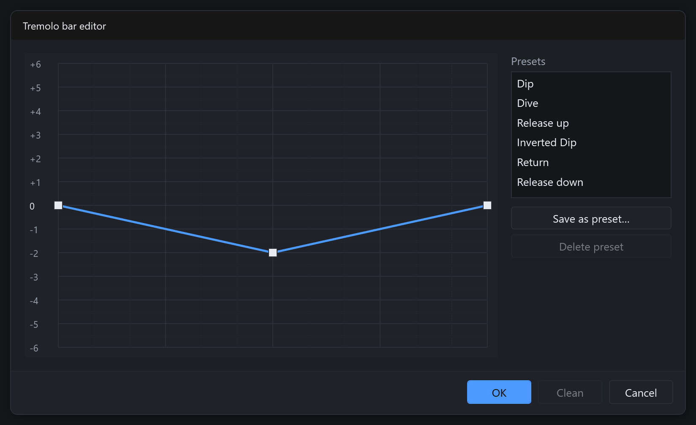</a><br><b>Tremolo bar editor</b><br>Dips, dives and returns drawn the same way, with presets and your own saved shapes.</td>
<td width="33%" valign="top"><a href="docs/screenshots/effect-trill.png">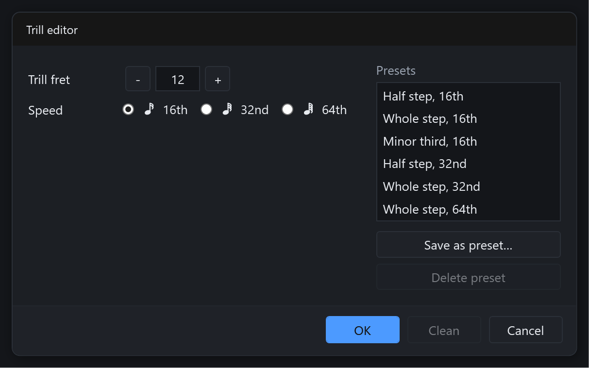</a><br><b>Trill editor</b><br>Sets the trill fret and its speed: 16th, 32nd or 64th.</td>
</tr>
<tr>
<td width="33%" valign="top"><a href="docs/screenshots/effect-grace.png">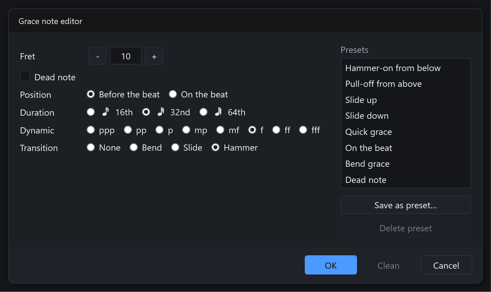</a><br><b>Grace note editor</b><br>Fret, position before or on the beat, duration, dynamic and the transition into the main note.</td>
<td width="33%" valign="top"><a href="docs/screenshots/effect-harmonic.png">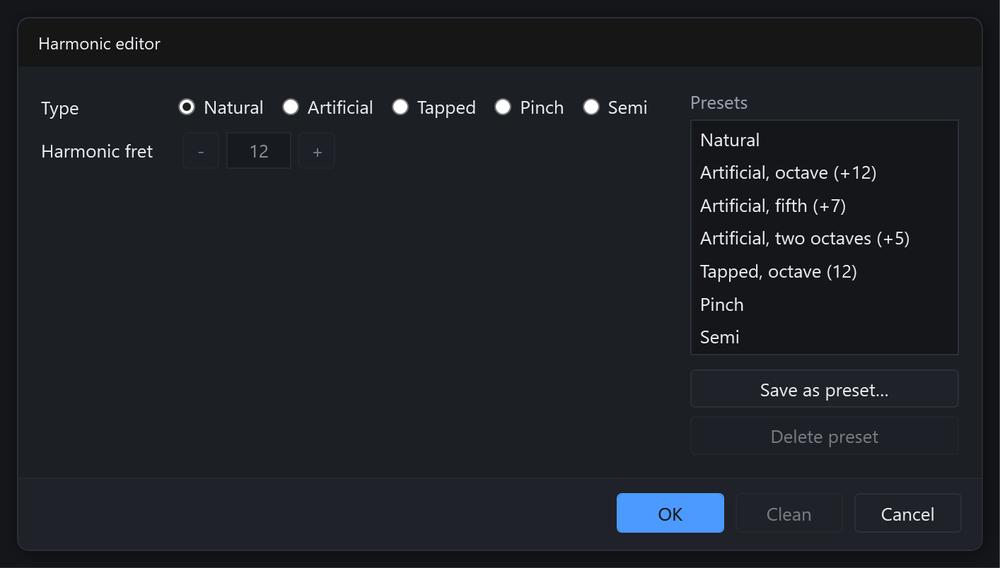</a><br><b>Harmonic editor</b><br>Natural, artificial, tapped, pinch or semi harmonics, with a fret box where one is needed.</td>
<td width="33%" valign="top"><a href="docs/screenshots/score-text-style.png">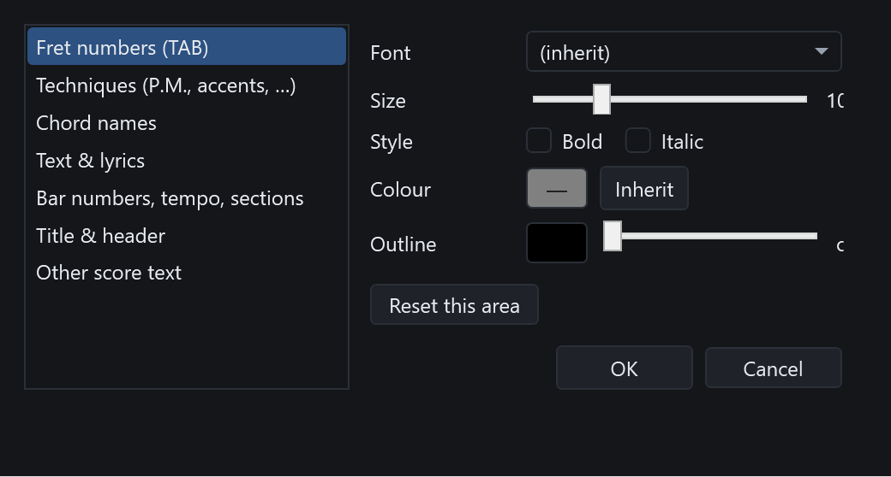</a><br><b>Score text styles</b><br>Fonts and sizes for each kind of text on the score.</td>
</tr>
</table>

- **30+ techniques**: bends, slides, hammer-ons, harmonics, palm mute, vibrato, tapping, slap and more.
- **Free rhythm entry**: a note can run past the end of the bar and the bar turns red instead of refusing (a strict mode exists). **Check bars (F4)** lists every bar that does not add up.
- **Edits during playback** are heard from the next bar.
- **Tools menu**: Transpose, Chord finder, Song stats, Scale finder and the Tuner.
- **Screen-reader support**: the tab editor announces track, bar, beat, string, fret and note name as the cursor moves.

<details><summary>More details</summary>

- **Techniques**: bends with curves, slides, hammer-ons/pull-offs, palm mute, let ring, vibrato and wide vibrato, natural/artificial/pinch/tapped harmonics, dead and ghost notes, tremolo picking, trills, fades, accents, staccato, tenuto, grace notes, arpeggio/brush strokes, tapping, slap and pop.
- **Edits during playback** are heard from the next bar. Bars you edit stay complete (*Fill incomplete bars with rests*, on by default); typing on a rest writes your remembered duration; *Advance after entering a note* (off by default) moves the caret on.
- **Tidy bars:** with "Add rests automatically to fill bars" on, changing a note's length moves the notes after it along, and the rests at the end of the bar take up the change.
- **Delete in the score:** a bar left without notes becomes one whole-bar rest.
- **32nd and 64th notes** typed back to back beam together, and a bar holds 32 or 64 of them.
- **Edit cursor:** a see-through yellow highlight on the tab and a grey box behind the selected note on the staff; pausing or stopping moves it to where playback stopped.
- **Drum staff:** the percussion clef sits inside the staff, every drum note has a stem, and notes in one voice share a stem and beam.
- Fermatas, text, **mix table points (F10)** for tempo, volume and pan changes, copy/cut/paste beats and bars, repeat selections, insert/delete beats that keep the bar length.
- Engraving uses the real clef on every system, with harmonics at the fretted pitch, slide strokes and slurs, strum arrows, repeat-bar signs and volta brackets.

</details>

## Instruments on screen

A fretboard, keyboard or drum map matches each track, lights up as the song plays, and writes a note when clicked.

<table>
<tr>
<td width="33%" valign="top"><a href="docs/screenshots/fretboard.png"></a><br><b>Fretboard</b><br>Strings in the track's own tuning. The sounding note glows, the next notes are outlined and a line shows where the hand moves.</td>
<td width="33%" valign="top"><a href="docs/screenshots/instrument-keyboard.png">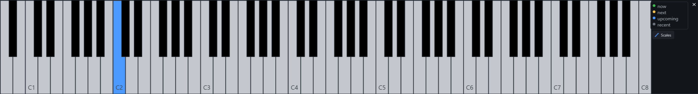</a><br><b>Keyboard</b><br>An 88-key keyboard, or 76, 61, 49, 37 or 25 keys, for keyboard tracks.</td>
<td width="33%" valign="top"><a href="docs/screenshots/instrument-drums.png">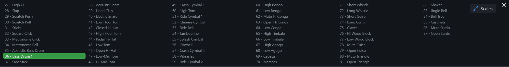</a><br><b>Drum map</b><br>A percussion map for drum tracks; the pieces light up as they are hit.</td>
</tr>
<tr>
<td width="33%" valign="top"><a href="docs/screenshots/fretboard-marker-size.png"></a><br><b>Note marker size</b><br>Circles and numbers scale together from 60% to 160%.</td>
<td width="33%" valign="top"><a href="docs/screenshots/fretboard-2026.png"></a><br><b>Appearance</b><br>Scale highlight as shaded cells, circles or rings in a colour you choose; fret-marker colours; left-handed view; note names; 12 or 24 frets.</td>
<td width="33%" valign="top"><a href="docs/screenshots/scale-finder.png">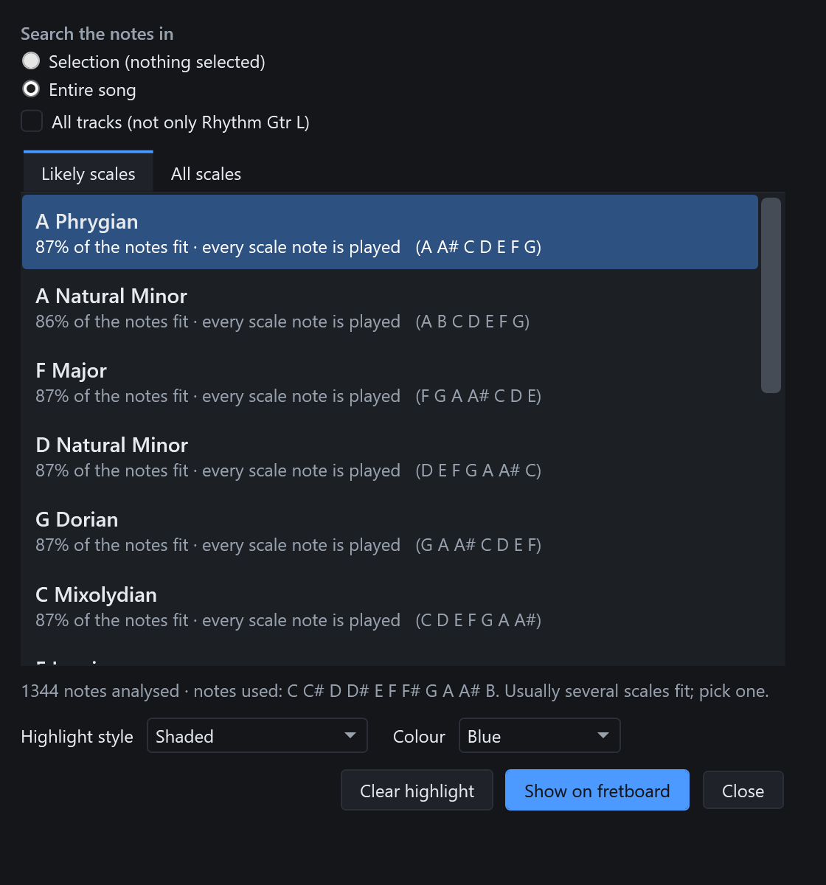</a><br><b>Scale finder</b><br>Lists the keys and scales that fit a selection or the whole song, best first, for one track or all.</td>
</tr>
<tr>
<td width="33%" valign="top"><a href="docs/screenshots/instrument-picker.png">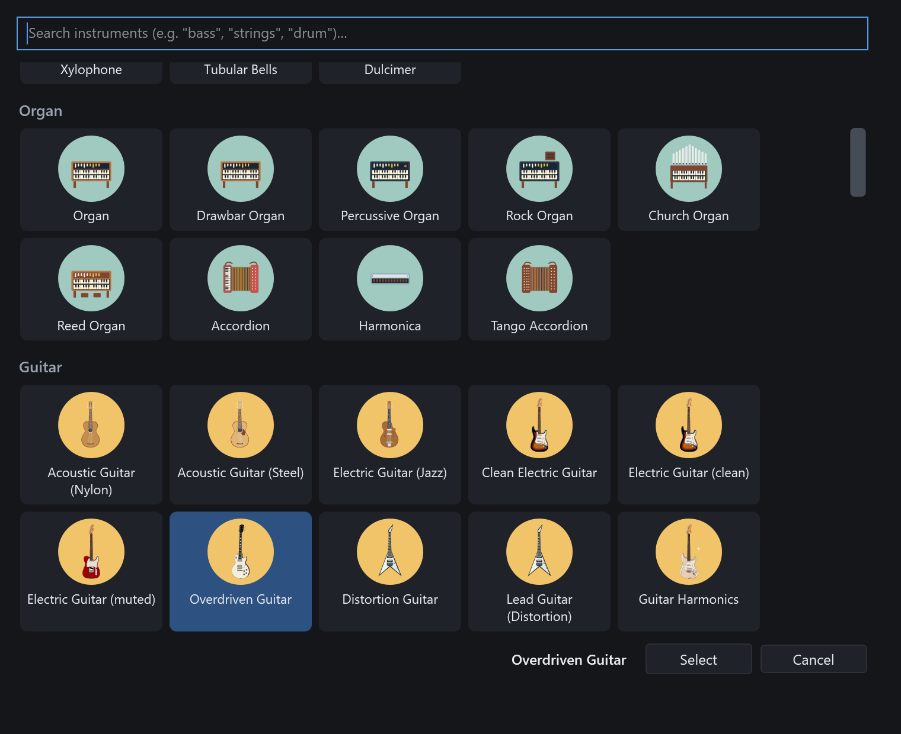</a><br><b>Instrument picker</b><br>The full General MIDI set with pictures, categories and search.</td>
<td width="33%" valign="top"><a href="docs/screenshots/track-properties-guitar.png">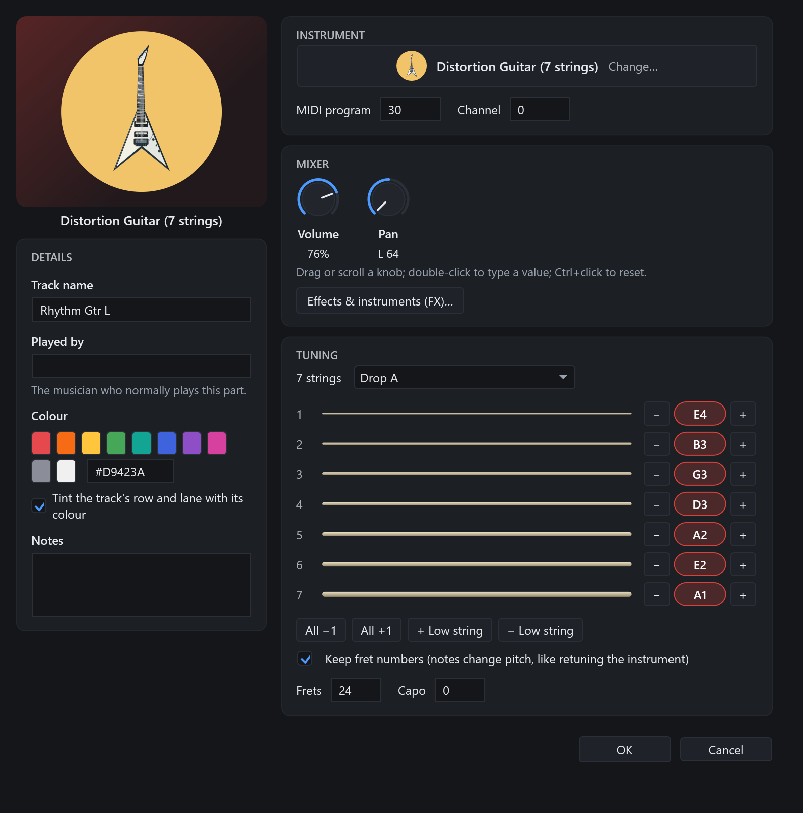</a><br><b>Tuning editor</b><br>Per-string tuning with presets for 4- to 7-string bass and 6- to 9-string guitar. Retuning keeps either the fret numbers or the pitches.</td>
<td width="33%" valign="top"><a href="docs/screenshots/track-properties-drums.png">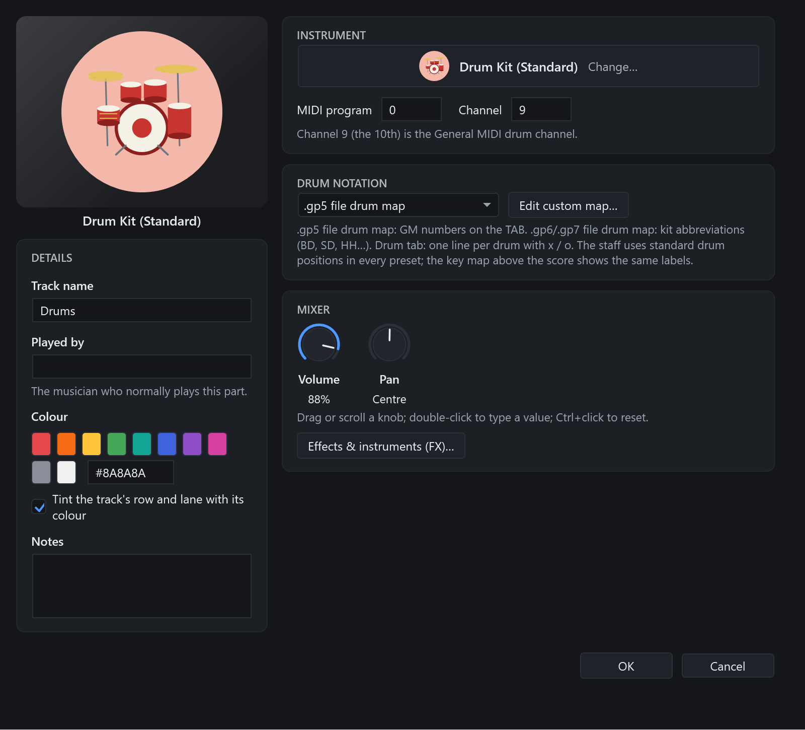</a><br><b>Drum notation</b><br>Presets plus a custom map: tab line, tab text, staff position and notehead for every drum sound.</td>
</tr>
</table>

<details><summary>More details</summary>

- Follows playback: the sounding note glows, the next notes are outlined, a line shows where the hand moves next. Chords move as one shape. Hover previews where a click would write.
- **Note marker size** (60% to 160%) scales circles and numbers together; 12 or 24 frets; alternative preview layouts.
- **String spacing** (right-click > *Appearance*, also in Settings and bindable): *Compact*, *Natural* (default) or *Wide*. A tall pane centres the board and a narrow pane scales the drawing down instead of squeezing the frets.
- **Appearance** (saved for every song): scale highlight as shaded cells, circles or rings in a colour you choose; fret-marker dots in several colours; keyboard keys grey or white.
- Right-click to show one track or all tracks differently; the default is in Settings > Fretboard.
- **Scale finder** (the **Scales** button, right-click > *Find scale…* or Tools > Scale finder): *Likely scales* analyses the **selection** or the **entire song**, for one track or all, and lists every fitting key and scale, best first; *All scales* picks any key and scale. *Scale > Clear selection* removes it.
- **Number size** (Small, Medium, Large) under right-click > Appearance and in Settings.
- **Keys sized from their width**: at most 24 px wide and centred, with the keyboard pane's own height.

</details>

## Arrangement and tracks

One block per bar and track, with coloured sections across the top. Sections, bars, clips and tracks all move by dragging.

<table>
<tr>
<td width="33%" valign="top"><a href="docs/screenshots/arrangement-timeline.png">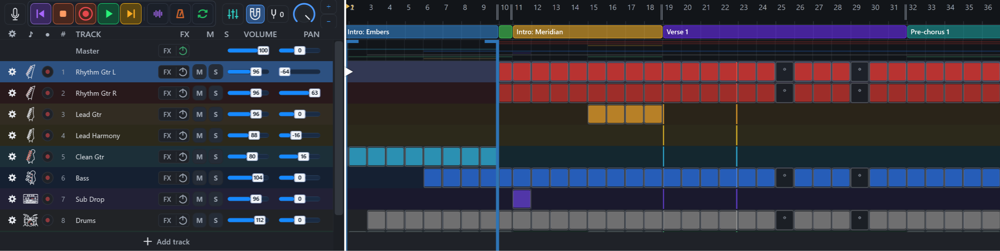</a><br><b>Timeline</b><br>Every bar of every track at a glance. Click to seek, drag across bars to select.</td>
<td width="33%" valign="top"><a href="docs/animations/section-move.gif"></a><br><b>Sections</b><br>Intro, Verse, Chorus and so on share a colour per type. Drag a section to move it with its bars and clips; Ctrl+drag moves only its marker.</td>
<td width="33%" valign="top"><a href="docs/screenshots/sections-panel.png">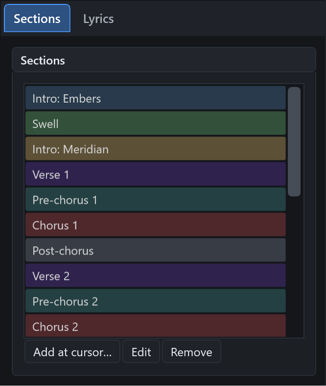</a><br><b>Sections panel</b><br>Add, rename, colour, loop and jump to sections. Lyrics is a tab beside it.</td>
</tr>
<tr>
<td width="33%" valign="top"><a href="docs/animations/arrangement-drag.gif">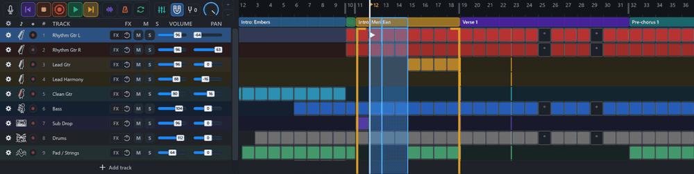</a><br><b>Bar selections</b><br>Copy, cut, paste, move, delete, loop or skip the selected bars during playback.</td>
<td width="33%" valign="top"><a href="docs/screenshots/timeline-delete-prompt.png">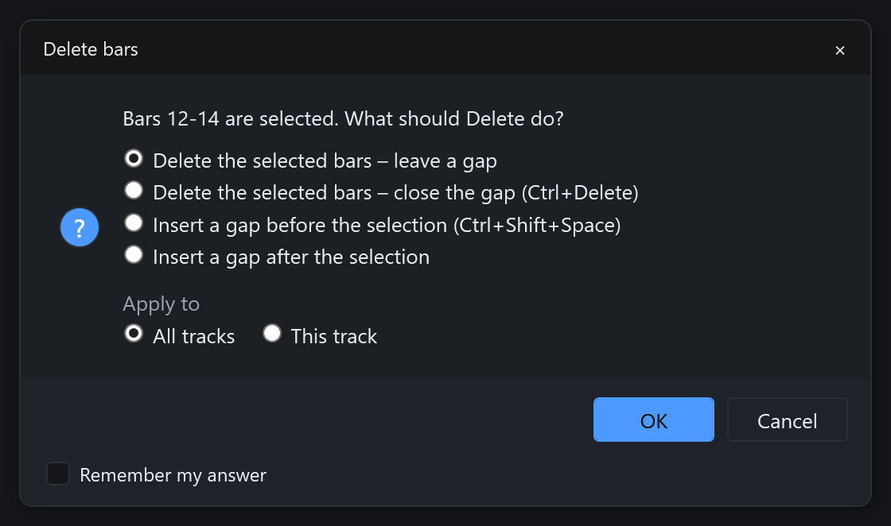</a><br><b>Delete on bars</b><br>One prompt: clear, remove and close the gap, or insert a gap, for all tracks or this one.</td>
<td width="33%" valign="top"><a href="docs/animations/track-reorder.gif">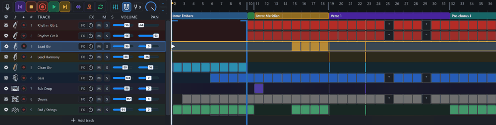</a><br><b>Reorder tracks</b><br>Drag a track row up or down, or use Alt+Up and Alt+Down.</td>
</tr>
<tr>
<td width="33%" valign="top"><a href="docs/screenshots/audio-track-row.png">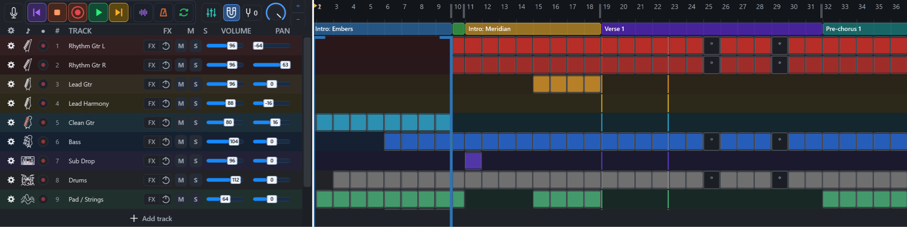</a><br><b>Audio tracks</b><br>A track that holds audio and MIDI clips and no notation. It can be converted to an instrument track and back.</td>
<td width="33%" valign="top"><a href="docs/screenshots/timeline-drop.png">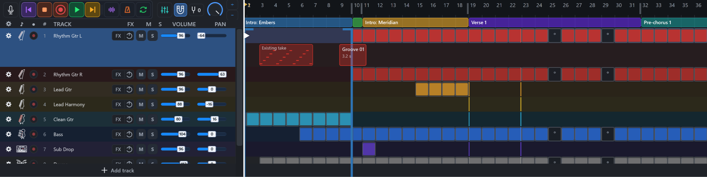</a><br><b>Drop files</b><br>Drop MP3, WAV, FLAC, OGG, AIFF, M4A, WMA or MIDI files on a track; a preview shows where they land.</td>
<td width="33%" valign="top"><a href="docs/screenshots/timeline-drop-new-lane.png">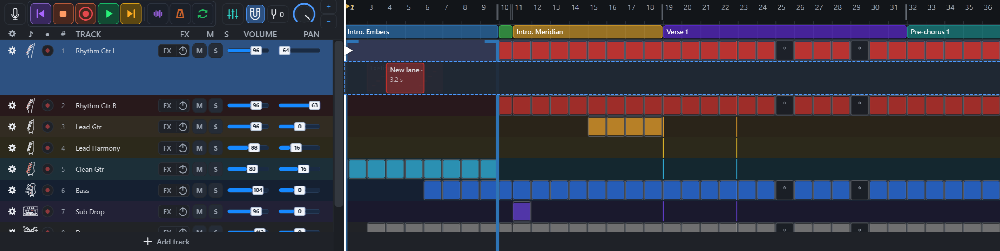</a><br><b>Lanes</b><br>Overlapping clips open a new lane on the same track.</td>
</tr>
<tr>
<td width="33%" valign="top"><a href="docs/screenshots/clip-edit-fades.png">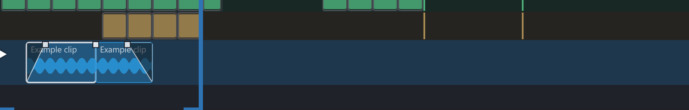</a><br><b>Split, glue and fade</b><br><b>S</b> splits at the edit cursor, Ctrl+Shift+G glues, and fade handles sit at the top corners of a clip.</td>
<td width="33%" valign="top"><a href="docs/screenshots/timeline-move-clip.png">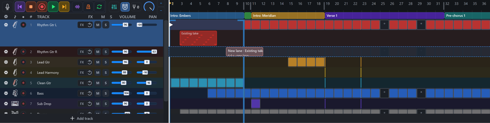</a><br><b>Move and snap clips</b><br>Drag a clip to another lane or track (Ctrl+drag copies). Snap aligns to the beat grid, the playhead or clip edges.</td>
<td width="33%" valign="top"><a href="docs/screenshots/audio-track-main.png">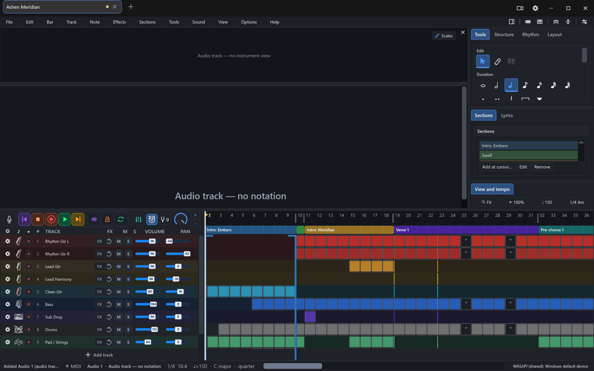</a><br><b>Track list</b><br>Arm, mute, solo, level, pan and FX on every row, with collapsible groups.</td>
</tr>
<tr>
<td width="33%" valign="top"><a href="docs/screenshots/add-track.png">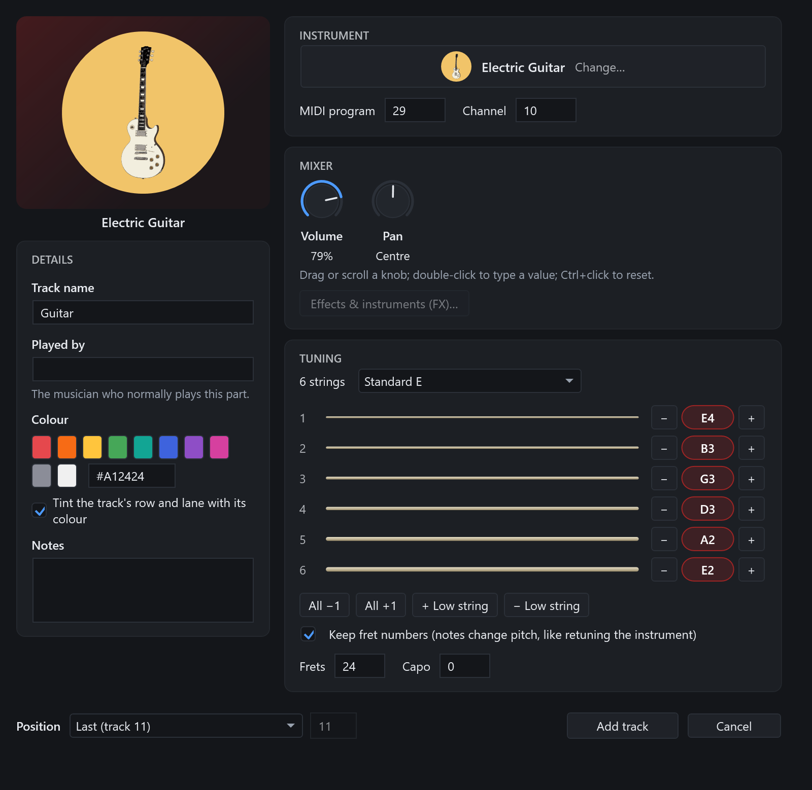</a><br><b>Add track</b><br>Instrument, tuning and where the track goes: last, first, after the selected track or as track number N.</td>
<td width="33%" valign="top"><a href="docs/screenshots/track-row-menu.png">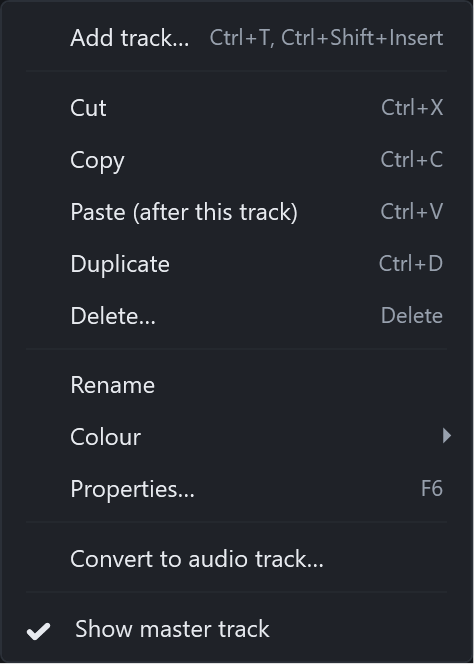</a><br><b>Track menu</b><br>Cut, copy, paste, duplicate, rename and colour whole tracks with their notation, clips, mixer settings and FX chain.</td>
<td width="33%" valign="top"><a href="docs/screenshots/track-groups-menu.png">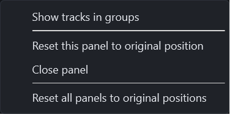</a><br><b>Groups</b><br>Show tracks grouped by instrument family, with a header row for each group.</td>
</tr>
<tr>
<td width="33%" valign="top"><a href="docs/screenshots/track-properties-bass.png">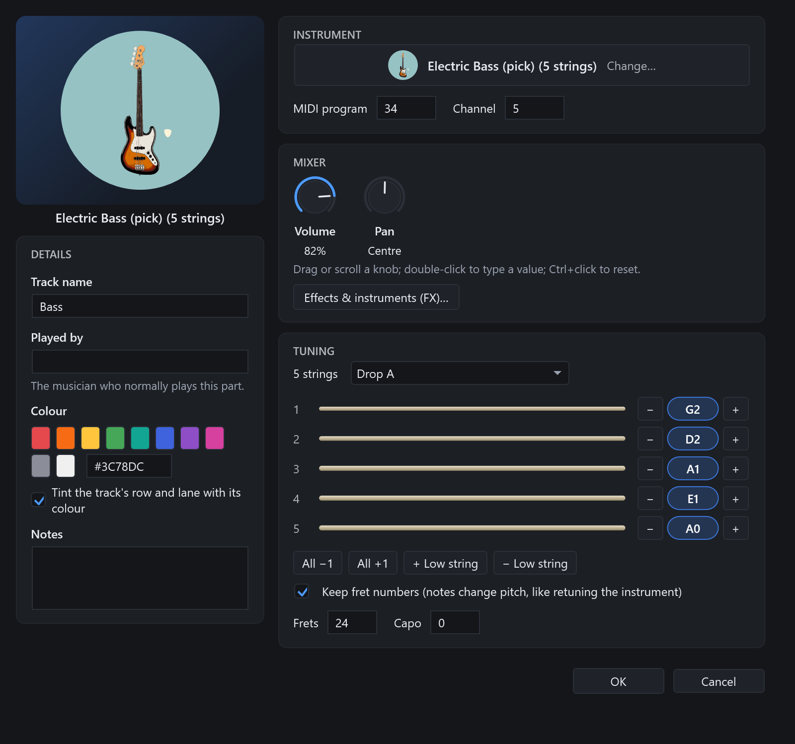</a><br><b>Track properties</b><br>Name, instrument, strings and tuning for a track (F6).</td>
<td width="33%" valign="top"><a href="docs/screenshots/global-tuning.png">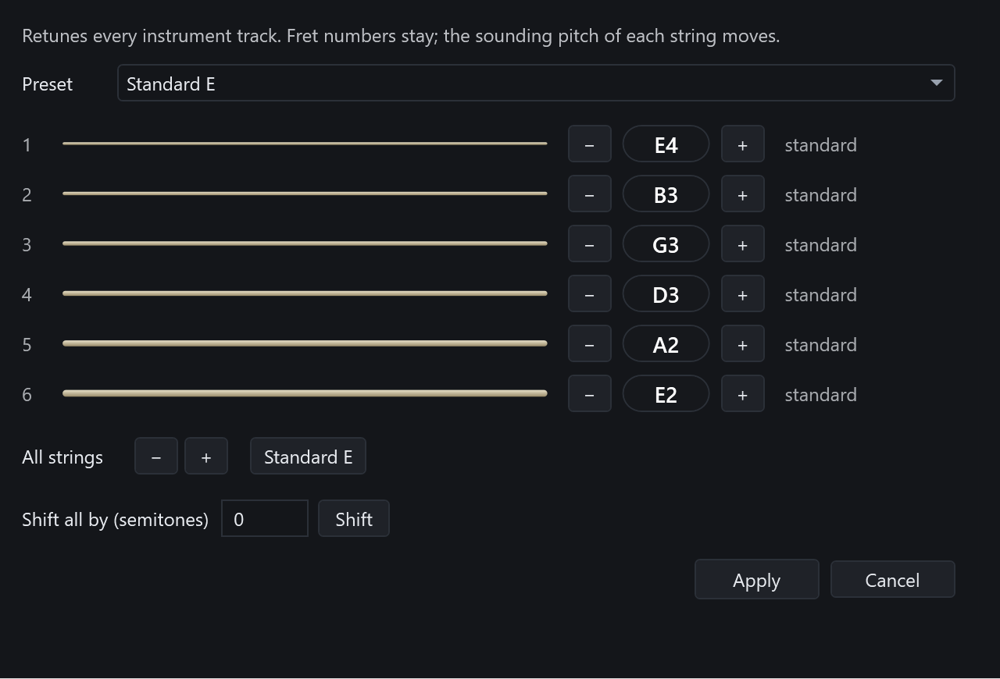</a><br><b>Global tuning</b><br>Shifts every track at once.</td>
</tr>
</table>

- **Add a track** from the Track menu, Ctrl+T, the Add track lane under the last track, or *Add track…* in the track list's right-click menu.
- **Master track lane** (track list right-click > *Show master track*): an overview above the first track, pictured under [New in 0.7.5](#new-in-075).
- **Selection scope:** a timeline selection covers every track; bars selected in the score cover just that track, and copy, cut, paste and loop follow it.

<details><summary>More details</summary>

- **Drag a section's edge to resize it**: shrinking leaves empty bars, growing pushes the next section along. `Esc` clears a selection.
- Right-click menus for bars, tracks and sections; drag tracks to reorder them.
- **Delete on bars** opens one prompt: clear (leave a gap), remove (close the gap) or insert a gap before or after, for all tracks or this track; Ctrl+Delete closes the gap, Ctrl+Shift+Space inserts a gap.
- **Add-track lane**: a strip under the last track (click it, or drop files on it); hide it in Preferences > Timeline & Tracks.
- **Sections carry their clips**: moving, copying or duplicating a section takes the clips inside it; the song grows to fit clips that run past its end.
- **S** splits the selected clip at the edit cursor, **Ctrl+Shift+G** glues, fade handles sit at the top corners. **Snap** aligns clips to a beat grid, the playhead or other clip edges; MIDI clips can be written into the track's notation.
- A live preview shows where a dropped file lands; overlaps open a new lane, and a MIDI groove lands on the song's bar grid. Drag a clip to another lane or track (Ctrl+drag copies it).
- **Clip edges extend past the media**: dragging an end beyond the source repeats it inside the clip (a dashed line marks each pass), and the song grows to hold it. With the snap magnet on, edges jump to beats.
- **Empty end bars are removed** when clips shrink (Settings > Editing > Clips, on by default), so moving or deleting clips does not leave blank bars at the end.
- **Collapsible timeline**: drag it down to about three track rows; its tracks and lanes then scroll with the mouse wheel.

An **audio track** holds audio and MIDI clips and has no notation. Right-click it > *Convert to instrument track* keeps every clip. Recording stops at the take's start; waveforms and MIDI notes appear while recording. Click anywhere on a lane to seek to that bar; clicking a take also selects it. Clips can be moved, trimmed, muted, duplicated, or edited through clip properties.

- **Tuning editor**: per-string `−`/`+`, double-click a string to type a note (e.g. `Eb3`), presets for 4-/5-/6-/7-string bass and 6-/7-/8-/9-string guitar, `+ / − Low string` to change the string count. Choose whether retuning keeps the fret numbers or the sounding pitches.
- **Track menu**: right-click a track row for Cut, Copy, Paste, Duplicate, Delete, Rename, Colour and Properties; whole tracks (notation, clips, mixer settings, FX chain) copy and paste. A focused track row takes Ctrl+C, Ctrl+X, Ctrl+V, Ctrl+D and Delete.
- **Mixer groups** collapse to one row and follow group rules you set for one song or all songs; a track's colour chip opens its colour palette.
- **Instrument and tool icons** are original artwork.

</details>

## Recording and live input

Capture song ideas quickly and turn them into notation and tab. It is a sketchpad for songwriting, not a full recording studio.

<table>
<tr>
<td width="33%" valign="top"><a href="docs/screenshots/recording-lanes.png">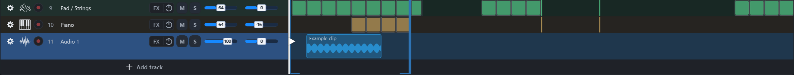</a><br><b>Takes in lanes</b><br>Ctrl+R records armed tracks into audio or MIDI clips. Overlapping and loop-recorded takes get their own lanes; click a take to choose it, Ctrl+click to layer.</td>
<td width="33%" valign="top"><a href="docs/screenshots/live-input.png"></a><br><b>Live input</b><br>The microphone button plays an audio input, a MIDI keyboard or both through a live FX chain and the master, with no track and no recording.</td>
<td width="33%" valign="top"><a href="docs/screenshots/tuner.png">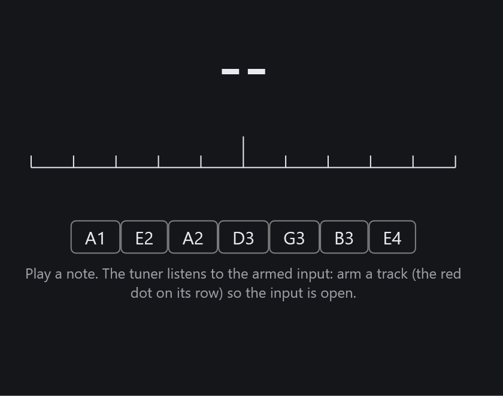</a><br><b>Tuner</b><br>Detects the pitch of the armed input and shows the note, a cents needle and the track's string tunings.</td>
</tr>
</table>

- **Inputs:** pick an audio input or *MIDI (all inputs)*, watch the meter, toggle monitoring. Every input of a multi-input device can be used, as one channel or a stereo pair; "Inputs shown" in the audio settings chooses which are listed.
- An armed audio track plays live MIDI through its instrument plug-in. Waveforms and MIDI notes appear while recording.
- MIDI clips can be written into the track's notation.
- **Pop protection:** changing the audio device or its settings fades the sound out and back in (on by default).

## Playback and practice

Play along with a metronome and count-in, loop any section, and let the speed trainer raise the tempo each pass.

<table>
<tr>
<td width="33%" valign="top"><a href="docs/screenshots/timeline-playhead-styles.png">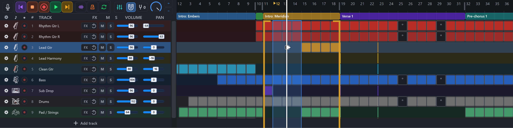</a><br><b>Playback marker</b><br>A line or a bar marker on the timeline. In the score, the green line and note glow show only while the song plays.</td>
<td width="33%" valign="top"><a href="docs/screenshots/score-horizontal.png"></a><br><b>Score views</b><br>Page or continuous layout, scrolling vertically or horizontally with the whole song on one line. Only bars near the view are drawn.</td>
<td width="33%" valign="top"><a href="docs/screenshots/mix-table.png">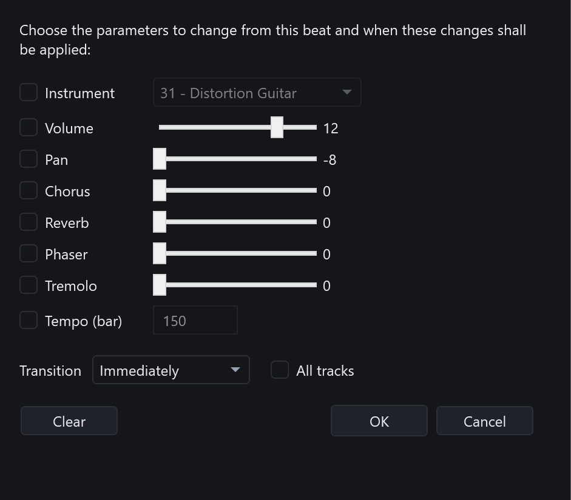</a><br><b>Mix table points (F10)</b><br>Tempo, volume and pan changes written into the song and played back.</td>
</tr>
</table>

- MIDI playback with per-track mute, solo, volume and pan, including bends, slides, let ring, palm mute and swing.
- **Metronome and count-in** with their own sounds, levels and subdivisions.
- **Looping** of the song, a section or a selection; a **speed trainer**; skip areas.
- **Zoom, speed and tempo** sit in the **View and tempo** pane at the bottom of the side panel (speed 25 to 200%).
- **Status bar tempo** follows the tempo in force at the playhead or the selected bar.

<details><summary>More details</summary>

- **Song structure played as written:** repeats (up to x99, several closes, multi-pass endings such as 1.2.3.), D.S. / D.C. / Coda / Fine, and tempo changes that last until the next one, including partway through a bar.
- **Score follow**: the view keeps the playing bar in sight and stops if you scroll by hand. Right-click the score > *Follow playback*: **Page turn** (default) or **Smooth page turn** (glided at the display refresh rate, idle in between).
- **Two score views** on the right-click menu: *Score layout* (page / continuous) and *Score scrolling*, **vertical** or **horizontal** (the whole song on one line). Only bars near the view are drawn, so long songs stay light.

</details>

## Band view, Keyboard mode and compact mode

### Band view

Every track gets its own row: an instrument view and a scrolling tab lane, each row as tall as the music it shows. Open it from the top bar or **View > Band view**.

<table>
<tr>
<td width="33%" valign="top"><a href="docs/screenshots/band-above.png"></a><br><b>Fretboard above the tab</b><br>The default: the tab uses the full row width. Only the first track shows its fretboard; the others start with a thin name strip.</td>
<td width="33%" valign="top"><a href="docs/screenshots/band-beside.png">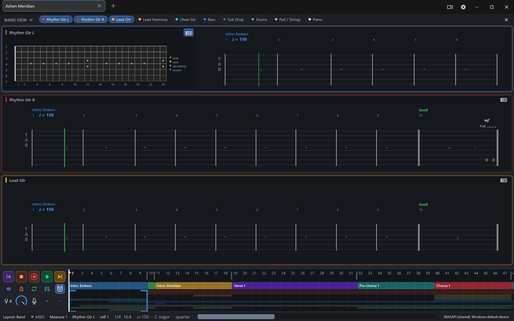</a><br><b>Fretboard beside the tab</b><br>For wide screens: the instrument sits in a column to the left of the tab. Chosen from the BAND VIEW drop-down.</td>
<td width="33%" valign="top"><a href="docs/screenshots/band-view-playing.png">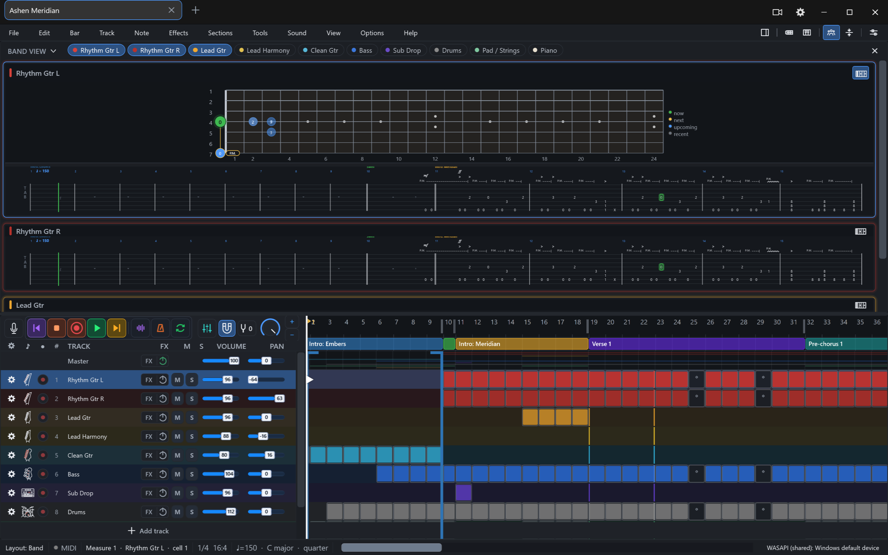</a><br><b>During playback</b><br>Every row keeps its playing line of music in view, also when rows have different heights.</td>
</tr>
</table>

- The first track gets two lines of music and the others one, when that fits. The drop-down also turns the track colour frame on or off, and *Reset view* returns to the defaults.
- The layout and colour frame belong to the program and are the same for every song; a song keeps only which of its tracks are shown and their order.
- The right-click menu has a **Row sizes** submenu; the playhead line is set in Preferences.

### Keyboard mode (experimental)

Practise a part by playing it along with a MIDI keyboard. Turn it on from the top bar or **View > Keyboard mode** (Ctrl+Alt+L).

<table>
<tr>
<td width="33%" valign="top"><a href="docs/screenshots/keyboard-mode.png">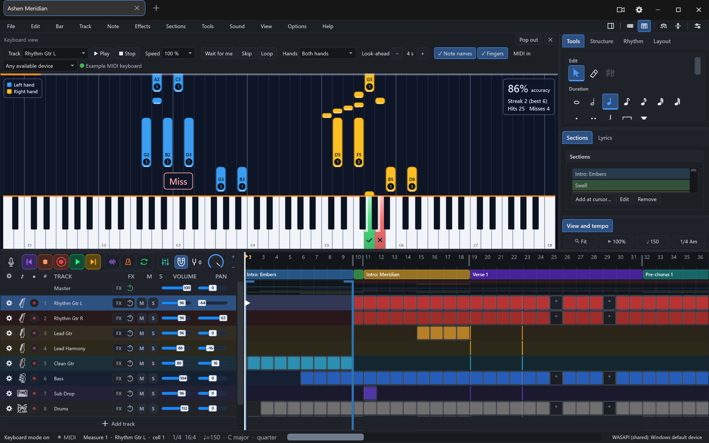</a><br><b>Falling notes</b><br>Any track as notes falling onto a piano keyboard in time with playback, in hand colours with note names and finger numbers.</td>
<td width="33%" valign="top"><a href="docs/screenshots/keyboard-mode-wait.png">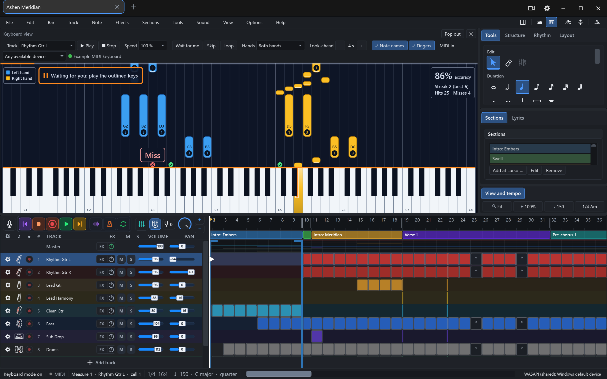</a><br><b>Wait for me</b><br>Ctrl+Alt+W holds the song at each chord until its notes are pressed, in any order. Skip (Ctrl+Alt+Q) moves on.</td>
<td width="33%" valign="top"><a href="docs/screenshots/keyboard-mode-popout.png">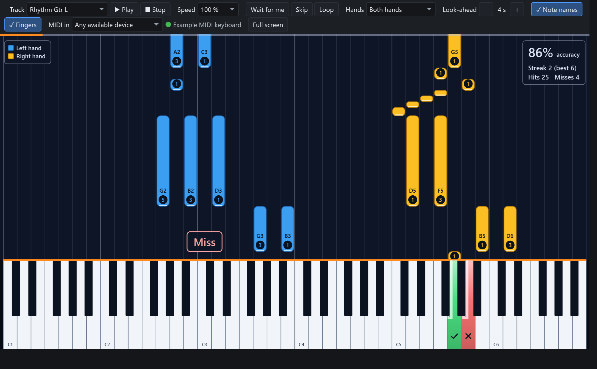</a><br><b>Pop out</b><br>Ctrl+Alt+O shows the falling notes in their own window; F11 makes it full screen.</td>
</tr>
</table>

- **Play along**: the selected track is silenced and your keys play its sound live; its mute is never changed. Correct notes turn green, wrong ones red, with an accuracy figure and streak.
- **Timing tolerance**: Strict, Normal or Relaxed (the default).
- **Control bar**: track selector, speed, loop, hands and zoom. The MIDI input defaults to any available device.

*Keyboard mode is experimental and has not been tried with every MIDI device. Please report anything odd.*

### Compact mode

Compact mode gives the score the room. It hides the track rows and the menu row, and shows the master track lane at twice its height. A strip of track capsules under the title bar selects the track (the selected one is lit); right-click the strip, or click its caption, for the menus and tools, and the track controls become a slim column of three rows of buttons. Turn it on from the toolbar button beside Keyboard mode or **View > Compact mode** (Ctrl+Alt+C); pressing it again brings the tracks back as they were. It is pictured under [New in 0.7.5](#new-in-075).

## Sound

Every track has level, pan, mute, solo and an FX chain. VST2 and VST3 instruments and effects load on any track, with MIDI processing in front of every plug-in.

<table>
<tr>
<td width="33%" valign="top"><a href="docs/screenshots/mixer.png"></a><br><b>Mixer</b><br>A row per track with the Master row at the top. Mute and solo are instant: solo wins, muted tracks are drawn grey.</td>
<td width="33%" valign="top"><a href="docs/animations/mixer.gif"></a><br><b>Levels and pan</b><br>Sliders on one fine scale. Double-click a knob and type "-6 dB", "75%" or "L30"; Ctrl+click resets.</td>
<td width="33%" valign="top"><a href="docs/screenshots/mixer-groups-collapsed.png"></a><br><b>Groups</b><br>Group rows set level, pan and pitch for all their tracks, collapse to one row, and each has an effects bus.</td>
</tr>
<tr>
<td width="33%" valign="top"><a href="docs/screenshots/mixer-group-rules.png"></a><br><b>Group rules</b><br>Rules decide which tracks fall into which group, for one song or all songs.</td>
<td width="33%" valign="top"><a href="docs/screenshots/mixer-colour-menu.png"></a><br><b>Track colours</b><br>A track's colour chip opens its colour palette.</td>
<td width="33%" valign="top"><a href="docs/screenshots/fx-chain.png"></a><br><b>FX chains</b><br>One instrument, then effects in series, each with bypass, wet/dry and its own window. Chains save and load as files.</td>
</tr>
<tr>
<td width="33%" valign="top"><a href="docs/screenshots/plugin-wiring.png"></a><br><b>Wiring</b><br>Audio channels, MIDI source and channel filter, sidechain, and MIDI forwarding to another track.</td>
<td width="33%" valign="top"><a href="docs/screenshots/fx-allow-again.png"></a><br><b>Plug-in approval</b><br>A plug-in that crashes or freezes is named and switched off; you choose when to allow it again.</td>
<td width="33%" valign="top"><a href="docs/screenshots/prefs-audio.png"></a><br><b>Audio output</b><br>WASAPI (shared or exclusive), ASIO or DirectSound, with device, sample rate and buffer size.</td>
</tr>
<tr>
<td width="33%" valign="top"><a href="docs/screenshots/midi-processing-overview.png"></a><br><b>MIDI processing</b><br>Processors run top to bottom before the plug-in, on the song, live keys and tracks routed to it.</td>
<td width="33%" valign="top"><a href="docs/screenshots/midi-processing.png"></a><br><b>Processor chain</b><br>Transpose, humanise, arpeggiator, step sequencer and more. Each can be bypassed, reordered by dragging and limited to some notes.</td>
<td width="33%" valign="top"><a href="docs/screenshots/midi-processing-search.png"></a><br><b>Search every parameter</b><br>One box finds processors and single parameters; Enter adds the processor or jumps to the parameter.</td>
</tr>
<tr>
<td width="33%" valign="top"><a href="docs/screenshots/midi-processing-velocity.png"></a><br><b>Velocity</b><br>Scale and offset, a fixed value, a compressor mode and variation accents.</td>
<td width="33%" valign="top"><a href="docs/screenshots/midi-routing.png"></a><br><b>MIDI routing</b><br>MIDI from another track or a live keyboard routed into an instrument plug-in.</td>
</tr>
</table>

- **Master FX and monitoring FX:** the Master row has an FX chain, pan and volume over the whole mix. A **MON** chain is heard live only and is never rendered or exported.
- **Fallback sound:** with effects but no VST instrument, the track's General MIDI sound plays through the effects; if a VST instrument stops, the track falls back to it.
- **Separate process:** plug-ins run in an audio engine process of their own; *Run each plug-in in its own process* isolates every plug-in separately. This is crash isolation, not a security sandbox: load only plug-ins you trust.
- **Saving:** `.gp` with the settings inside, a clean `.gp` plus `.tfaudio`, or `.tforge`.

**Current limits:** sidechain input works with VST2 plug-ins that have four or more inputs; offline rendering does not yet compensate plug-in delay on sidechain and bus routes; a compatible .gp export lists what it cannot keep before you save. Plug-ins run with your Windows permissions (the separate-process option protects TabForge from crashes, not your files).

<details><summary>More details: plug-ins, mixer and the MIDI processors</summary>

- With effects but no VST instrument, the track's own General MIDI sound plays through the effects (rendered from Windows' own sound bank); a *MIDI sound* switch turns it off.
- **Audio output** device, sample rate and buffer size are in **Settings > Audio & VST**. Plug-in folders are added by browsing (no automatic scan unless you turn it on). Changing the audio device or its settings fades the sound out and back in, so speakers do not pop (Protect speakers from pops when audio settings change, on by default).
- **Safety**: plug-ins run in a separate audio engine process that starts only when a track uses plug-ins; if one crashes or freezes, TabForge names it, switches it off and carries on. *Run each plug-in in its own process* isolates every plug-in separately (a little more CPU). This is crash isolation only, not a security sandbox: load only plug-ins you trust.
- **Wiring** selects audio input channels, the MIDI source/channel filter, sidechain input (VST2 with four or more inputs) and MIDI output forwarding to another track.
- **Serial MIDI chain:** MIDI flows through the plug-in list in order; instruments add their audio, effects process everything before them.
- **Per-plug-in MIDI processors** run right before their plug-in: note mapping, transposition, velocity, humanisation, delay, CC tools, scale/chord tools, arpeggiator, randomizers, LFOs, step sequencer, audio-to-MIDI drum trigger and loopers. Each has an "Applies to" note filter; whole-list presets (with built-ins) and a search that indexes every parameter; all saved with the song.
- **Group rows** set level, pan and pitch for all their tracks at once; tracks can be moved between groups. The Mixer is the fader button beside the tuning fork.
- Renders pass through a transparent safety limiter.

**MIDI processors** (the **MIDI…** button in the FX chain):

- **Velocity**: scale and offset, fixed value, compressor mode, variation accents.
- **Pitch**: transpose (±64), note map for drum maps, snap to scale / key, chord (up to four voices).
- **Timing**: humanizer, MIDI delay (ms, beats or samples).
- **Filtering and routing**: channel filter / remap and router, note range filter, choke and choke group, duplicate-note sanitizer, note hold.
- **Controllers**: program / bank select, CC sender and mapper, LFO to any CC or pitch wheel.
- **Generators**: note repeater, arpeggiator, randomizers, step sequencer.
- **Audio-coupled**: audio-to-MIDI drum trigger, MIDI EQ ducker, loop sampler, synchronized looper.
- **Utilities**: All notes off / Panic and a live **MIDI log**.

**Every parameter is searchable**: one box finds processors and individual parameters ("Processor › Parameter"); Enter adds the processor or jumps to the parameter. Processors can be limited to some notes and to an input channel. A note-off always follows its note-on, so nothing hangs. Each processor can be bypassed, reordered by dragging, and set by typing into its knobs. Whole chains save as **presets**, built-in ones such as "Humanize light" and your own.

</details>

## Export

<table>
<tr>
<td width="33%" valign="top"><a href="docs/screenshots/render.png"></a><br><b>Render audio</b><br>Ctrl+Alt+R: the master mix, track stems or both, for the song, a selection or a custom range, as WAV 16/24/32-bit float or MP3.</td>
<td width="33%" valign="top"><a href="docs/screenshots/video-export-dialog.png"></a><br><b>Export video</b><br>File > Export > Video (MP4): the song as a video that plays itself with the full mix, at 1080p or 4K and 30, 60 or 120 frames per second.</td>
<td width="33%" valign="top"><a href="docs/screenshots/record-video-button.png"></a><br><b>Record video</b><br>The camera button (Ctrl+Alt+V) plays the song and records the chosen part of the screen and everything you hear to MP4.</td>
</tr>
</table>

| Format | Open | Save |
|---|---|---|
| `.gp3`, `.gp4`, `.gp5`, `.gpx` | ✔ | |
| `.gp` | ✔ | ✔ (default) |
| TabForge project (`.tforge`) | ✔ | ✔ |
| Standard MIDI (`.mid`), ASCII tab (`.txt`), PDF, MusicXML (`.musicxml`) | | export |
| Audio (WAV, MP3) and video (MP4) | | export |

- **Video layouts**: one track with its fretboard, keyboard or drums; score only; Band view; or score and Band view. Choose the range (whole song, selection, bars or a section), the tracks, and dark or light.
- **Recording** covers the score, Band view, the whole window, or score with instrument. A red REC time shows in the status bar; stopping saves the file in Videos\TabForge.
- Score-only export is about twice as fast, and the progress bar shows the phase and time left.
- **PDF** gives engraved notation and tab as A4 pages; **Print** and **Print preview** are in the File menu.

<details><summary>More details</summary>

Drum parts import from every format, including `.gpx` extended articulations and `.gp` drum kits. Known limit: .gp3/.gp4/.gp5 files open with up to 20,000 bars per track. `.gtp` and `.tg` files are not supported.

A `.gp` saved by TabForge follows the `.gp` file format **and** carries the complete TabForge project inside it (an extra entry other readers can ignore), so reopening it in TabForge loses nothing: drum map, section sizes, score styles, mix points. Saved `.gp` files carry correct zip checksums and keep the album, copyright, tab author, music, words and instructions fields.

**File > Render…** exports the master mix, track stems or both, for the full song, a selection or a custom range, with tail length, file-name wildcards and WAV 16/24/32-bit float; MP3 bit rates are offered when Windows has an encoder. Rendering shows progress and can be cancelled. PDF export gives engraved notation and tab as A4 pages.

</details>

## Customising

<table>
<tr>
<td width="33%" valign="top"><a href="docs/screenshots/main-window.png"></a><br><b>Dockable panes</b><br>Drag any pane by its tab to dock, tab, split or float it. Layouts are remembered; Compose, Practice and Mix are on Ctrl+1/2/3.</td>
<td width="33%" valign="top"><a href="docs/screenshots/main-window-light.png"></a><br><b>Themes</b><br>Dark, Light and System, with every colour adjustable. One click sets interface, accent, icons and score page together.</td>
<td width="33%" valign="top"><a href="docs/screenshots/command-palette.png"></a><br><b>Command palette</b><br>Ctrl+Shift+A searches every command by name, shows its key and runs it with Enter.</td>
</tr>
<tr>
<td width="33%" valign="top"><a href="docs/screenshots/settings-hotkeys.png"></a><br><b>Shortcuts</b><br>Two shortcuts per command, presets for TabForge, Classic and Alternative, and conflict warnings.</td>
<td width="33%" valign="top"><a href="docs/screenshots/settings-search.png"></a><br><b>Searchable settings</b><br>Every setting can be found by name, with a live preview before you apply.</td>
<td width="33%" valign="top"><a href="docs/screenshots/project-settings.png"></a><br><b>Project settings</b><br>Settings that belong to one song and are saved with it.</td>
</tr>
<tr>
<td width="33%" valign="top"><a href="docs/screenshots/tutorial-basic.png"></a><br><b>Tutorial</b><br>Help > Tutorial: a Basic Guide in seven short chapters.</td>
<td width="33%" valign="top"><a href="docs/screenshots/tutorial-detailed.png"></a><br><b>Detailed Guide</b><br>A longer guide with search and Export PDF.</td>
</tr>
</table>

- **Document tabs in the title bar**: several songs open at once and several tabs can play at the same time; drag a tab to reorder, out to a new window, or onto another TabForge window.
- **Top bar icons** are grouped by kind and can be dragged into another order.
- **Message boxes** follow the light or dark theme.
- Settings import and export as one file; **Reset all** and **Import** cover every section, and a second TabForge window follows settings changed in the first.

**Preferences pages** (F12)

<table>
<tr>
<td align="center" valign="top"><a href="docs/screenshots/settings-general.png"></a><br>General</td>
<td align="center" valign="top"><a href="docs/screenshots/settings-appearance-colours.png"></a><br>Appearance and colours</td>
<td align="center" valign="top"><a href="docs/screenshots/settings-score-notation.png"></a><br>Score and notation</td>
<td align="center" valign="top"><a href="docs/screenshots/settings-playback-sound.png"></a><br>Playback and sound</td>
<td align="center" valign="top"><a href="docs/screenshots/settings-audio-vst.png"></a><br>Audio and plug-ins</td>
<td align="center" valign="top"><a href="docs/screenshots/settings-editing.png"></a><br>Editing</td>
</tr>
<tr>
<td align="center" valign="top"><a href="docs/screenshots/settings-timeline-sections.png"></a><br>Timeline</td>
<td align="center" valign="top"><a href="docs/screenshots/settings-fretboard.png"></a><br>Fretboard and keyboard</td>
<td align="center" valign="top"><a href="docs/screenshots/settings-tabs-windows.png"></a><br>Tabs and windows</td>
<td align="center" valign="top"><a href="docs/screenshots/preferences-common-settings.png"></a><br>Common settings</td>
<td align="center" valign="top"><a href="docs/screenshots/preferences-search.png"></a><br>Search results</td>
</tr>
</table>

**Menus**

<table>
<tr>
<td align="center" valign="top"><a href="docs/screenshots/menu-file.png"></a><br>File</td>
<td align="center" valign="top"><a href="docs/screenshots/menu-edit.png"></a><br>Edit</td>
<td align="center" valign="top"><a href="docs/screenshots/menu-bar.png"></a><br>Bar</td>
<td align="center" valign="top"><a href="docs/screenshots/menu-track.png"></a><br>Track</td>
<td align="center" valign="top"><a href="docs/screenshots/menu-note.png"></a><br>Note</td>
<td align="center" valign="top"><a href="docs/screenshots/menu-effects.png"></a><br>Effects</td>
</tr>
<tr>
<td align="center" valign="top"><a href="docs/screenshots/menu-sections.png"></a><br>Sections</td>
<td align="center" valign="top"><a href="docs/screenshots/menu-tools.png"></a><br>Tools</td>
<td align="center" valign="top"><a href="docs/screenshots/menu-sound.png"></a><br>Sound</td>
<td align="center" valign="top"><a href="docs/screenshots/menu-view.png"></a><br>View</td>
<td align="center" valign="top"><a href="docs/screenshots/menu-options.png"></a><br>Options</td>
<td align="center" valign="top"><a href="docs/screenshots/menu-help.png"></a><br>Help</td>
</tr>
</table>

<details><summary>More details</summary>

- **Layout**: score in the middle (standard notation + TAB, or either alone), fretboard on top, arrangement timeline and track list at the bottom, tool palette and sections on the right.
- **Drag any panel by its tab**; the landing place is highlighted in blue. Drop on the middle of a panel to add a tab there, near an edge to split, or outside the window to float it (drag back to re-dock). Resize splits by dragging; hide panels from the View menu; **Reset all panels to original positions** (View menu) restores everything.
- **Themes**: one click sets interface, accent, icons, transport buttons and score page together (the light theme is a soft grey with a wood-coloured fretboard). Score paper, notation, staff lines, playback colours and fonts can still be changed (Settings > Appearance & colours).
- A "Classic" shortcut preset is included; every command shows its shortcut, and every shortcut can be changed.
- **Themes**: dark, light and system presets or fully custom colours; interface scale applies live; score fonts per text area.
- **Help > About** shows the version, the independent-project notice and a **Licences** button.
- **Windows integration**: turn "Open .gp and .tforge files with TabForge" on or off.
- Shift+F10 or the Menu key opens the right-click menu in the score, timeline and fretboard.

</details>

### Keyboard basics

| Keys | Action |
|---|---|
| `0`–`9` | Enter a fret (type two digits quickly for 10+) |
| `←` `→` / `↑` `↓` | Previous/next beat / string up/down |
| `+` `-` `.` | Shorter / longer note (reversible in Settings), dotted |
| `Space` / `Shift+Space` | Play/pause / play from the start |
| `F9` | Loop on/off |
| `Ctrl+Z` / `Ctrl+Y` | Undo / redo |

## Files, safety and updates

<table>
<tr>
<td width="33%" valign="top"><a href="docs/screenshots/new-from-template.png"></a><br><b>Templates</b><br>File > <i>New from template</i> (built-in and your own) and <i>Save as template</i>.</td>
<td width="33%" valign="top"><a href="docs/screenshots/autosave.png"></a><br><b>Autosave and recovery</b><br>Unsaved songs are copied to the Recovery folder every 1 to 30 minutes and offered back after a crash.</td>
<td width="33%" valign="top"><a href="docs/screenshots/update-available.png"></a><br><b>Update check</b><br>An optional daily check that only reads the latest version number. TabForge never downloads or installs anything itself.</td>
</tr>
</table>

- **Safe saving:** files are written to a temporary file and swapped in atomically; a `.gp` plus `.tfaudio` pair is restored to its last complete state if a save is interrupted.
- **Untrusted input:** every file, clipboard paste and settings file is size-checked and validated before use.
- **Plug-ins** load only after you scan or approve them, and only while the file is the one you approved.
- **No telemetry, no auto-updates, no analytics.** The update check is the only network access: one anonymous HTTPS GET, at most once a day, to `https://api.github.com/repos/cobhc95/TabForge/releases`. Switch it off in **Settings > General > Updates**; Help > *Check for updates…* checks now.
- **Windows integration** ("Open .gp and .tforge files with TabForge") is opt-in and reversible.
- **Command line:** `TabForge.exe song.gp5 [more files]` opens files as tabs; `--theme dark|light|system` starts with that theme.

<details><summary>Security and privacy in full</summary>

TabForge treats every file, clipboard paste and settings file as **untrusted input**:

- **Bounded reads everywhere**: projects and score files are capped at 128 MB, settings at 2 MB, JSON
  nesting at 64 levels. Files are size-checked *before* they are read into memory.
- **Structure limits** checked before and after parsing — e.g. at most 256 tracks, 20,000 bars per track,
  1,000,000 notes, 16 strings, 64 techniques per note, 512 bend points — to keep the memory and CPU a crafted file can use bounded
  (hardened continuously; not a guarantee). Every loaded project, undo snapshot and paste is validated the same way.
- **Zip-bomb safe `.gp` reading**: the embedded project is inflated with a hard cap (its declared size is
  not trusted), and anything wrong falls back to the normal import.
- **Safe saving**: files are written to a temporary file and swapped in atomically, so a crash or full disk
  never leaves a half-written song; paths and extensions are checked before writing.
- **Crash safety**: an unexpected error is logged, every song with unsaved changes is copied to
  `%LOCALAPPDATA%\TabForge\Recovery`, and you are told where — the window stays open so you can save.
- **Plug-ins are isolated from the editor, for crashes**: folder discovery is bounded and does not run plug-in code inside
  TabForge. Plug-in identification and audio hosting use separate processes; an individual plug-in can still
  crash or hang its host, so keep backups. **This is crash isolation, not a security sandbox**: a plug-in runs
  with your user rights (in its own process too), so load only plug-ins you trust.
- **A plug-in is loaded only if you scan or approve it, and only while it is the file you approved**: a song can
  only name plug-in paths. Outside Program Files / Common Files an approval covers that exact file (its SHA-256),
  network and removable locations always need an approval, and a file that changed is not loaded until you
  approve it again (a new build signed with the same key is accepted).
- **Update check — the only network access, and deliberately tiny.** No telemetry, no auto-updates, no
  analytics. The optional update check (on by default; switch at the top of **Settings > General > Updates**,
  and a tick box in the update window itself) is limited to:
  - **one anonymous HTTPS GET, at most once a day**, to a single fixed address —
    `https://api.github.com/repos/cobhc95/TabForge/releases` — about 8 seconds after start-up, in the background;
  - **nothing sent** except the User-Agent GitHub requires (`TabForge/<version>`): no account, no cookies, no
    identifiers, no file or song information;
  - **TLS 1.2/1.3 only** with normal Windows certificate validation; **no redirects followed**, no cookies stored,
    no credentials, no decompression; 10-second timeout; the reply is capped at **256 KB** (headers 64 KB) and
    must be JSON;
  - **only two fields are read** from the reply (`tag_name` and `draft`) and a tag is accepted only if it is a
    plain version such as `v0.1.0-beta.2` (strict pattern, time-limited regex) — no text, links or files from
    GitHub are shown, opened or saved;
  - the **download page is built locally** from that validated version on `github.com/cobhc95/TabForge`, and it
    only opens in your browser when you click *Open download page*; **TabForge never downloads or installs
    anything itself**;
  - **offline or blocked networks are silent** (no error pop-ups); nothing runs when it is switched off, except
    Help > *Check for updates…* when you choose it; the program's unattended command-line runs never contact the network.
  Diagnostics are opt-in, size-capped and never include your music.
- **Windows integration is opt-in and reversible**: it writes only TabForge's own per-user entries
  (`HKCU\Software\Classes\TabForge.*` and TabForge in each extension's *Open with* list), never takes over a
  file type another program already owns, and turning it off (or uninstalling) removes exactly those entries.
- **Minimal supply chain**: a small, listed set of dependencies (alphaTab, NAudio, MeltySynth, SoundTouch.Net, plus a native VST3
  bridge built from the Steinberg VST3 SDK; see [THIRD_PARTY.md](THIRD_PARTY.md)), pinned with lock files, restored
  in locked mode and checked by NuGet's vulnerability audit on every build.

</details>

<details><summary>Resources and performance</summary>

TabForge is built to stay light while you write and play:

- No per-frame work unless something is actually moving: the score, timeline and fretboard redraw only what
  changed; drum-hit glows animate only while they fade.
- Precompiled (ReadyToRun) and memory-conserving .NET settings; memory is returned to Windows after loading
  a song; undo history is stored compressed (about 1% of the raw size).
- Playback runs on its own high-precision thread; the interface only observes it, so a busy UI never
  makes the music stutter, and settings changes never restart the engine unless they change the sound.
- Adjustable in Settings: smooth-scroll frame-rate cap, follow mode (off / jump / smooth), fretboard and
  highlight effects, panels you do not need can be hidden.
- In normal use on a modern CPU it typically uses **~150–250 MB RAM and ~1–2% CPU**.

</details>

## Full feature reference

Every command can be found in the menus, the command palette and the shortcut settings (all rebindable).

<details><summary>Show the full feature reference</summary>

#### Files, tabs and export
- **New**, **New tab**, **Open**, **Open in new tab**, **Save**, **Save as**, **Close tab**, **Duplicate tab**, Exit.
- **Templates**: File > *New from template* (built-in and your own) and *Save as template* (your templates live in `%APPDATA%\TabForge\Templates`).

- **Export**: Standard MIDI, ASCII tab, **PDF** (engraved notation and tab as A4 pages, no printer needed), **MusicXML** (`.musicxml`, one part per track with a tab staff), clean **`.gp`**, **Render to audio** (WAV / MP3, master and stems), **video export** (MP4) and **record video** (Ctrl+Alt+V).
- **Print** and **Print preview**; **Score information** (F5).
- **Command palette** (Ctrl+Shift+A): fuzzy-search every command by name, see its key, press Enter to run it.

- **Autosave and recovery**: unsaved songs are copied to the Recovery folder every 1 to 30 minutes (Settings > General); after a crash or power loss TabForge offers to reopen them. Your own files are never overwritten.

- **Safe saving**: atomic writes, and a `.gp` plus `.tfaudio` pair is restored to its last complete state if a save is interrupted.
- **Command line**: `TabForge.exe song.gp5 [more files]` opens files as tabs (Explorer double-click hands over to the running instance, or opens a new window, as you choose); `--theme dark|light|system` starts with that theme (kept in your settings).
- Drag-and-drop tabs between windows; **Windows 11 Snap Layouts** on the maximise button; full-screen mode (F11).

#### Editing and notation
- Note entry: fret digits, arrow navigation, **durations** (whole to 64th, increase/decrease, dotted, double dotted, triplet), rest, tie, fermata, accent, staccato, tenuto, **shift pitch** by semitone, **move to higher/lower string** (Alt+Up/Down in the score), copy last beat.
- **Effects**: dead, ghost, palm mute, let ring, hammer/pull, bend, legato and shift slide, vibrato, wide vibrato, tremolo bar, natural and artificial harmonics, tapping, slap, pop, trill, tremolo picking, fade in/out, wah open/close, brush and arpeggio up/down, grace note, chord names, beat text, lyrics.
- **Bars**: insert, delete, duplicate, repeat selection as bars, time signature, key signature, clef, triplet feel, repeat open/close, directions and endings, double bar, repeat one or two bars, section editor, **Check bars (F4)**, **Go to bar**, mix table points (F10).
- Insert/delete beats, cut/copy/paste, select whole track, full undo/redo (fast on large songs).
- **Copy, cut and paste** of beat ranges (from the cursor, flowing over bar lines by the target's time signature) and whole bars, shared with the timeline clipboard. Pasting onto notes inserts the copied beats in the bar, and "Remember my choice" (Preferences > Editing > Copy and paste) covers the rest (overwrite or insert before/after, keep the pitch or shift an octave, bar settings); it works between instruments (guitar to bass, other tunings, drums) and **Paste special** (Ctrl+Shift+V) offers Replace, repeats, an octave shift and keep string and fret. Every paste is one undo step and cutting bars empties them.
- **Tools menu**: Check bar duration, **Transpose**, **Scale finder**, **Tuner**, **Metronome**, **Count-in**, preview note sound.
- **Tuner**: a chromatic tuner; the engine detects the pitch of the armed input and shows the note, a cents needle and the track's string tunings with the nearest string highlighted.

- **Score views**: tab + standard, tab only, standard only; dark or light score page; continuous line or individual notes; page/continuous layout; vertical or horizontal scrolling; zoom 75 / 100 / 150 % and Ctrl+/- zoom; **stylesheet** (F7).
- **Screen-reader support**: the tab editor announces track, bar, beat, string, fret and note name as the cursor moves, and every control has an accessible name and a stable id.

#### Side panes and panels
- **Compact mode** (View menu, Ctrl+Alt+C): hides the track rows and the menu row, with a header strip of track capsules.
- **View and tempo** pane: zoom, speed, tempo, time and key in one row at the bottom of the side panel; **Lyrics** is its own pane beside Sections.
- **Tools** (durations, dynamics, effects, bar structure), **Structure**, **Rhythm** and **Layout** palette pages, pinnable quick strip.
- **Sections** panel; **Lyrics**; **Scale highlight**; **Song stats** and **Chord finder** in the **Tools** menu.
- **Zoom and speed** in the **View and tempo** pane at the bottom of the side panel: zoom out/in, zoom box and the single playback-speed box (25 to 200 %, presets 50 to 200 %). The View menu zoom items and the hotkeys also work.

- **Speed hotkeys**: Ctrl+Alt+Up (faster), Ctrl+Alt+Down (slower), Ctrl+Alt+0 (back to 100 %).
- **Layouts**: Compose, Practice and Mix (Ctrl+1/2/3), save, delete, reset; show/hide the side panel and the fretboard; *Reset all panels to original positions*.
- Loop settings (loop count, speed trainer that raises the tempo each pass), metronome and count-in settings (volume, click sound, subdivision, accent).

#### Fretboard, keyboard and drums
- Fretboard, 88-key (or 76/61/49/37/25) keyboard and drum percussion map; left-handed view, note names, 12/24 frets, scale highlight and *Clear selection*, appearance options (circles or rings, colours, fret-marker dots, key colours).
- **Number size** (Small, Medium, Large) under right-click > Appearance and in Settings; **Lock fretboard size** (off by default, right-click menu and hotkey); the pane scales its drawing when resized; alternative preview layouts.

- **Show / hide the fretboard** (toolbar button and hotkey), *Switch instrument view*, per-track or all-tracks instrument view.

#### Tracks and Mixer
- **Add** Guitar, Bass, Drums, Keys or any instrument (Track menu, the Add track lane or Ctrl+T, with position choice), delete, move up/down, **Track properties** (F6), instrument picker, tuning editor, drum notation presets, **Global tuning**, next/previous track, multitrack (F3) and global (F8) views.
- **Track list**: arm, mute, solo, level, pan, FX button (red "!" if a plug-in was switched off), collapsible **groups**, *Show tracks in groups* (right-click empty space or from the Mixer), *Auto-resize track list to fit*, Alt+Up/Down to reorder.

- **Mixer**: instrument, compact or ungrouped views; Master row at the top with **MON** monitoring FX (live only, never rendered); **drag and drop** tracks or whole groups (the track list reorders in step, one undo step per drop, animated); group rows set level, pan and pitch for all tracks; Master row with FX, pan and volume; smooth sliders on one fine scale; **Alt+Up / Alt+Down** moves the selected track or group.

- **Selected-track routing** and MIDI output device; detailed track mixer; test selected track output; MIDI / audio setup.

#### Recording and clips
- **Record** (Ctrl+R) audio or MIDI clips, arm track, input meter, live monitoring, multiple take lanes, loop-recorded takes, recording offset.
- **Live input** (microphone button in the track list toolbar) and **audio inputs**: every input of the device, as channels or stereo pairs.
- **Clip commands** (bindable): delete, deselect, move (coarse and fine), move between lanes, copy, cut, paste, duplicate, mute, properties (F2), **Snap** on/off (Alt+S).

#### Plug-ins and audio engine
- **VST2 / VST3** instruments and effects, serial chains, wiring window, MIDI processing (many processors, presets, search), **group bus FX** and **master FX** chains, plug-in trust and *Review* prompts, crash isolation with a per-plug-in process option, automatic pitch matching, startup tracks.
- **Audio output**: WASAPI, ASIO, DirectSound; **Windows MIDI latency** with a **Measure** button; every song plays through the audio engine by default (a Settings toggle).

- **Render window**: range, stems checklist, tail length, file names, WAV / MP3, progress and cancel.

#### Playback and practice
- Play / pause, play from start, stop, loop (F9), first/last bar, previous/next section, go to section.
- Repeats up to x99, D.S./D.C./Coda/Fine, tempo changes (also mid-bar), mix-table fades, dynamics, technique playback; **score follow** with page turn or smooth page turn (stops only on a genuine manual scroll).

#### Settings and help
- Preferences (F12) with search, themes (Dark, Light, System), colours, fonts, interface scale, project settings, import/export of all settings, **Keyboard shortcuts** (F1) with TabForge, Classic and Alternative presets, **Check for updates**, About, Windows file-association option.

#### Menus, panels and windows in detail

**Score / tab editor right-click menu**
- Show standard notation, pitch up / down a semitone, move to the string above / below, delete note, zoom in / out / fit width and zoom percentages, *Score options*.
- *Score layout* (page / continuous), *Score scrolling* (vertical / horizontal), *Follow playback* (page turn / smooth page turn), *Score page* (dark / light), *Text & fonts*, *Playback line colour*, *Duration glow colour*, *Playback and glow settings*, ledger lines (standard, minimal, hidden), hide grid in empty bars, subtle bar glow.

**Fretboard / keyboard right-click menu**
- *Keyboard size* (88 to 25 keys), *Appearance* (number size, scale highlight style and colour, fret-marker colour and brightness, key colours), *Scale* (select scale, off, find scale, clear selection), *Preview next notes*, *Preview layout* and *Preview length*, *Note names*, *Left-handed*, *Lock fretboard size*, the per-track or all-tracks *Fretboard* choice, and a shortcut to Settings > Fretboard.

**Arrangement timeline menus**
- *Selected area*: copy, cut, paste before, move (click the new position), delete, loop, skip during playback, play all skipped areas again, clear selection (Esc).
- *Bar*: copy bar (this track or all tracks), copy section, paste bar into this track or all tracks, paste section here, add bar in front / behind, delete bar (this track or all tracks).
- *Section*: add section at bar, copy, cut, paste, duplicate, delete, loop section, go to section, edit title, lock / unlock position, show section brackets, same colour for similar sections, group colours.
- *Clips*: duplicate, copy, cut, paste, delete, mute, properties, write into the track's notation, advanced notation conversion, add audio file.
- Tracks can be dragged to reorder; panels close or reset from their own menu (*Reset this panel to original position*, *Close panel*).

**Track list menus and controls**
- Empty-area menu: *Show tracks in groups*, *Auto-resize track list to fit*, *Reset column layout*.
- Track and group rows: mute, solo, arm, volume and pan as **knob or slider** (choice in Settings), *Centre pan*, *Set exact pan*, track colour tint, instrument-family group headers with their own controls, right-click a group to open the Mixer at it.

**FX chain window**
- Add / remove plug-ins, *Add FX chain to the end*, *Save FX chain*, *Load FX chain*, *Clear chain*, per-plug-in power (bypass), wet/dry, its own plug-in window (docked in the FX window or floating, always on top optional), *Through chain*, *GM sound* with auto-switch, *Match pitch automatically*, *Auto-load for this instrument*, *Add as a track on startup*, track volume, plug-in folders and audio settings, *Wiring* and *MIDI processing* buttons.
- **Wiring**: audio input channels, MIDI source and channel filter, sidechain 3/4, pass MIDI on, send MIDI output on, instrument output add / replace, MIDI output forwarding to another track.
- **MIDI processing**: search, add processors, reorder (move up / down), remove, enable / bypass, "Applies to" note filter with learn, drum-map folder and reload, presets (save, load, delete), *Configure MIDI input*, and a live MIDI log.

**Render window**
- Source: master mix, stems (checked or all tracks), or master plus stems; range: entire song, time selection, selected bars, custom seconds; tail (auto until silent); file name wildcards and output folder; WAV 16 / 24 / 32-bit float and MP3 128 / 160 / 192 / 320 kbps; sample rate, mono mix-down, engine rate, threads, real-time pace for streaming samplers, open the folder when done, progress and cancel, warning when a plug-in did not load.

**Preferences (F12), every page**
- *General*: check for updates, open Explorer songs in a new tab or window, autosave, default save format, file association, toolbar and status-bar visibility, confirm before closing unsaved work, warn before discarding settings.
- *Appearance & colours*: theme, UI scale, track colour tint, density, reduce animations and animation speed, accent / selection / hover colours, custom palette, fonts, icon size, score fonts, spacing, ledger and staff opacity, bar numbers, section headings, hover and selection intensity, score paper, ink and line colours, edit cursor colour.
- *Score & notation*: default display (tab + staff, tab only, staff only), follow mode and its options (horizontal / vertical, look-ahead, trigger, manual-scroll pause, frame rate), playing-note and duration tint, playback line colour and thickness.
- *Playback & sound*: metronome (click and accent notes, volumes, subdivisions), count-in bars, playback speed, note preview, let-ring limit.
- *Audio & VST*: driver, device, ASIO channels and inputs, play through the engine, GM auto-switch, pitch matching, startup tracks, Windows MIDI latency and Measure, follow Windows volume, recording device and offset, sample rate, buffer size, plug-in folders, common folders, remember the list, plug-in window docking, always on top, per-plug-in process.
- *Editing*: default note value, advance after entering, reverse + / - keys, strict bar length, confirm bar deletion, wheel scroll distance, track volume / pan control style.
- *Timeline & sections*: same colour for similar sections, brackets, glow intensity, bracket thickness, confirm section deletion, animate section dragging, scrollbar.
- *Fretboard*: position, frets, left-handed, note names, default instrument view, keyboard size and key colours, marker colour and brightness, number size, preview style (TabForge or alternative layouts), look-ahead notes, scale highlight, update during playback.
- *Tabs & windows*: window size memory, tab shape, widths, height, title size, close button, double-click / middle-click actions, new-tab position, opening behaviour, drag a tab out or onto another window, mark playing tabs.
- *Hotkeys* (search, presets, conflict warnings) and *Advanced*; settings import / export, reset page, reset all, live preview with Apply / Cancel.

**Side panes**
- *Tools*, *Structure*, *Rhythm* and *Layout* pages hold the tool palette (durations, dynamics, effects, bar structure, rhythm and layout tools); right-click a tool to pin it to the quick strip.
- *Sections*: add, edit, delete, colour, loop and go to a section. *Lyrics*: per-track lyrics editor. Song stats and chord finder are in the **Tools** menu. Zoom and speed are in the View and tempo pane (see above).

**Tool palette pages, every tool**
- *Tools* page: **Edit** (selection cursor, erase note, change accidental); **Duration** (whole to 64th note, dotted, double-dotted, tie, triplet, choose tuplet ratio); **Dynamic** (ppp, pp, p, mp, mf, f, ff, fff); **Beat** (chord, choose chord, text annotation, brush down / up, pick-stroke down / up); **Effects** (vibrato, bend, tremolo bar, slide, dead note, hammer-on / pull-off, ghost note, accent, heavy accent, let ring, natural harmonic, grace note, trill, tremolo picking, palm mute, staccato, tapping, slapping, popping, fade in).
- *Structure* page: **Key and bars** (key signature, triplet feel, free time, double barline); **Step through** (back / forward one beat); **Markers** (add marker, marker list, previous / next marker); **Repeats and directions** (one-bar repeat, two-bar repeat, score directions); **Bar editing** (insert bar before the cursor, add bar at the end, duplicate bar, delete bar, check bar durations); **Bars** (time signature, tempo change, repeat start, repeat end / count, alternate ending).
- *Rhythm* page: **Tuplets and ties** (N-tuplet, tie note, tie beat / chord); **Sounding pitch and duration** (sound duration, 8va, 8vb, 15ma, 15mb).
- *Layout* page: **Voices** (voice 1, voice 2, gray inactive voice); **Beaming** (automatic beaming, force beam group, break primary / secondary beam); **Stems** (automatic and inverted stem direction); **System layout** (force / prevent line break).
- Palette pages can be tabbed or side by side, and any tool can be pinned to the quick strip.

**Lyrics pane**
- *Lyrics*: its own pane beside Sections; type or paste the song's lyrics, they are stored with the song when you leave the box.
- *Fretboard options*: **Preview** (preview next notes, note names, left-handed, look-ahead count) and **Scale highlight** are in the fretboard's right-click menu; **Fretboard frets** and the rest are in Preferences > Fretboard.
- *Tools menu*: **Chord finder…** (root, type, show, insert name on the cursor beat), **Song stats…** (tracks, bars, notes, sections) and **Scale finder…**.
- *MIDI / Audio setup* (Sound menu): the selected track's MIDI output device, with a test sound. The **Mixer** window (View menu) holds the track mixer.

**Preferences: Advanced page**
- An informational page only (no runtime toggles): it points to settings import / export, reset page and reset all, which are always available from the Preferences window footer.

</details>

## Verify your download

The downloads are not code-signed, so Windows SmartScreen may warn when you first run
them. Releases built by the GitHub Actions release workflow from the tagged source come with build attestations
(`gh attestation verify <file> --repo cobhc95/TabForge`) and SHA-256 checksums, so you can verify that a
download matches that build.

Each release attaches the installer (`TabForge-<version>-setup.exe`), the portable ZIP (`TabForge-<version>-win-x64-portable.zip`) and SHA-256 checksums. The installer offers a Start menu entry, an optional desktop icon and an optional *"Open .gp and .tforge files with TabForge"* association, for your Windows account only. Songs double-clicked in Explorer open as a new tab in the running TabForge (or a new window; see Settings > General).

A `licenses/` folder beside `TabForge.exe` (portable zip and installer) holds the full licence texts of every bundled component. SoundTouch.Net (LGPL-2.1) ships as a separate, replaceable `SoundTouch.Net.dll`; each release attaches its source.
## Building from source

Requires the .NET 8 SDK on Windows.

```cmd
dotnet build src\TabForge\TabForge.csproj -c Release
```

Or publish a self-contained build with `dotnet publish src\TabForge\TabForge.csproj -c Release`.

## Releases and issues

Downloads and release notes: [Releases](https://github.com/cobhc95/TabForge/releases). Bugs and ideas:
[Issues](https://github.com/cobhc95/TabForge/issues) - the song file and the steps to reproduce help a lot.

## Licence

The demo song in the screenshots, *Ashen Meridian*, is original and included (CC0).

MIT — see [LICENSE](LICENSE). Score file reading/writing uses [alphaTab](https://github.com/CoderLine/alphaTab) (MPL-2.0);
see [THIRD_PARTY.md](THIRD_PARTY.md). Full licence texts ship in the `licenses/` folder (SoundTouch.Net, LGPL-2.1, is a replaceable DLL). TabForge is an independent project and is not affiliated with, sponsored or endorsed by any other software maker.
