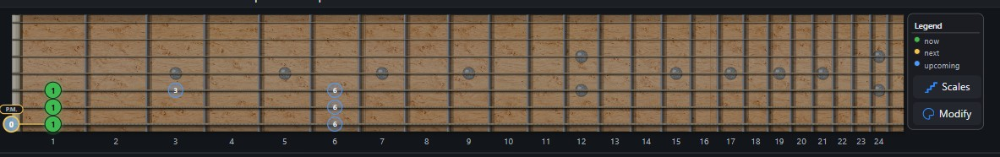
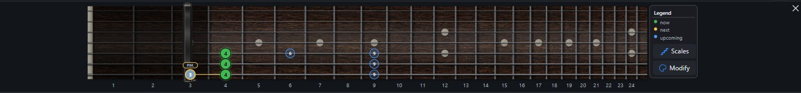
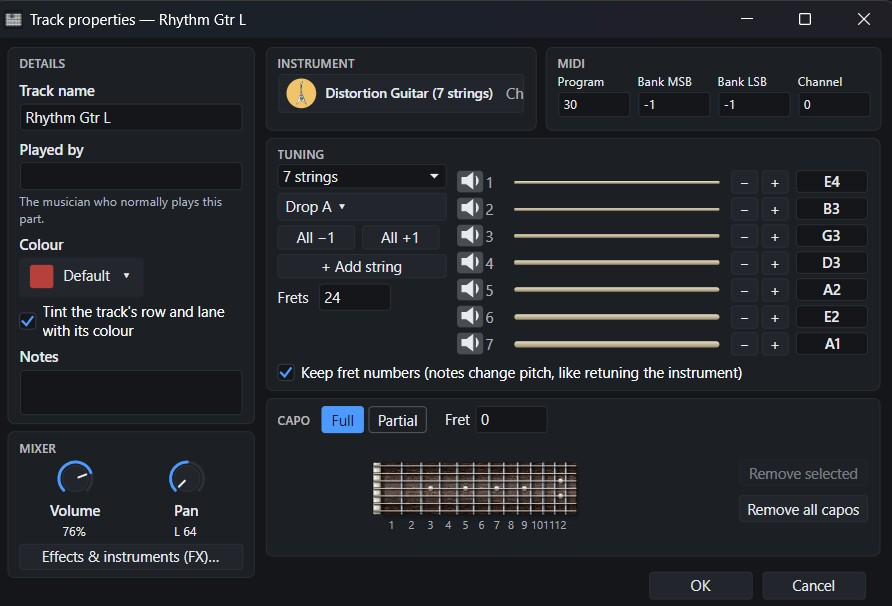
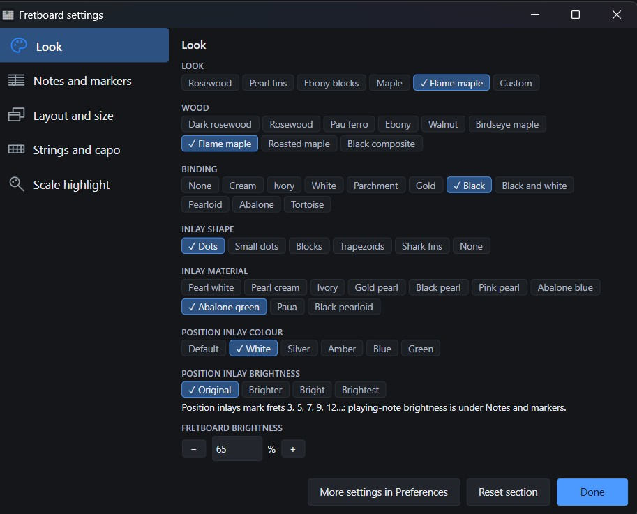
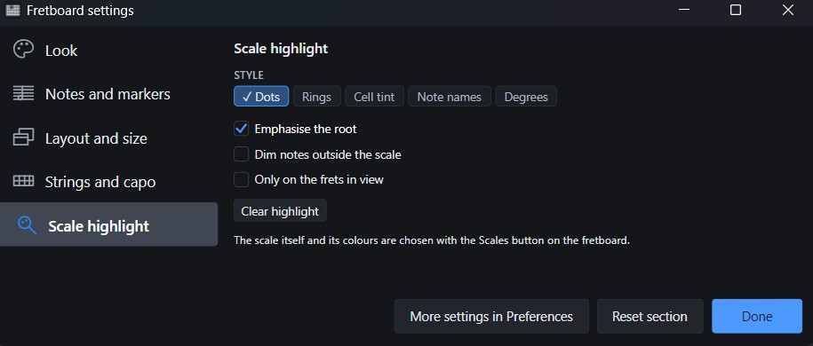

# TabForge 0.8.7

**Find your scale.** Automatic scale detection and best-match suggestions share your choice across the status bar, fretboard and piano roll. Compare keys, choose the tracks to analyse, or keep a manual scale. This capability already shipped in 0.8.6; it headlines this overview without being counted as new.

## New in 0.8.7

- **A fretboard that looks like an instrument:** layered wood, real fret spacing, wound strings, shaded binding and material inlays. Five presets include Flame maple with green inlays, with 65% default brightness and contrast controls in Fretboard settings.
- **Full and partial capos:** place and drag them on the board or in Track properties. Up to four partial capos can cover different strings; notes, playback and score labels follow them.
- **Tuning and Track properties:** 3-to-10-string tuning presets, your own saved tunings, per-string audition and compact instrument, MIDI and mixer cards. Edits stay in the draft until OK.
- **Plug-ins:** Windows 32-bit VST2 helpers, bridged VST3 editor windows, and Approve all / Approve selected with progress and Stop.
- **Linux, experimental:** AppImage first, tar.xz as a fallback. Both include pinned Wine 9.21, tfvst helpers for supported Windows VST2/VST3 plug-ins, and a pinned LGPL FFmpeg for Video export. No separate Wine or FFmpeg installation is required; normal desktop libraries are still needed.

## Fixes and performance

File > Open avoids nested waits, slow-folder checks and overlapping Ctrl+O requests. Playheads follow display frames; meter menus stay meter-only, scale tooltips stay anchored, and reapplying the recommended UI size is a no-op.

Plug-in filtering, piano-roll note queries, retained paths, moving markers, icon preparation, hidden editor polling and General MIDI bank changes do less repeated work. A local 5,000-entry filter smoke test measured about 2.5 ms warm filtering logic—not end-to-end search latency or a controlled 220-to-2.5 ms speedup claim.

See [CHANGELOG.md](../../CHANGELOG.md).

## Downloads

- Windows installer: `TabForge-0.8.7-setup.exe`
- Windows portable: `TabForge-0.8.7-win-x64-portable.zip`
- Linux, experimental, primary: `TabForge-0.8.7-x86_64.AppImage`
- Linux, experimental, fallback: `TabForge-0.8.7-linux-x64.tar.xz`
- SHA-256 checksums: `TabForge-0.8.7-SHA256.txt` (Windows) and `TabForge-0.8.7-linux-SHA256.txt` (Linux), attached to the release

This is a stable release. The Linux packages are experimental.

## Screenshots

<table>
<tr>
<td width="33%" valign="top"> Flame maple fretboard with layered wood and real fret spacing.</td>
<td width="33%" valign="top"> A capo on the board; notes and labels follow it.</td>
<td width="33%" valign="top"> Track properties: a 7-string tuning in Drop A, with capo controls.</td>
</tr>
<tr>
<td width="33%" valign="top"> Fretboard settings: presets, wood, binding and inlays.</td>
<td width="33%" valign="top"> Scale highlight styles for the fretboard.</td>
<td width="33%" valign="top"></td>
</tr>
</table>

## Known limits

- Linux has not been tested on real hardware. Distro startup, XWayland editors, virtual-audio paths and settings/prefix upgrades remain unproven; package parity does not prove desktop compatibility.
- Some JUCE 8 editors render black under Wine.
- Bridged plug-in load ceilings depend on buffer size; eight plug-ins may require about 1,024 frames, and the tested single-plug-in floor was 256 frames.
- One tested native Windows 64-bit VST2 instrument crashes the audio engine because of a plug-in fault; this route is not isolated. Fixture names are not published.
- One effect produces a reproducible offline/realtime difference with EQ engaged; it remains a reported probe rather than an audio-equivalence claim.
- No full-suite-green result, pixel-parity result or real-hardware compatibility certification is claimed.

For the AppImage, make it executable and run it. For tar.xz, extract with `tar -xJf` and run `TabForge.AppDir/AppRun`. The packaged `MIN_GLIBC.txt` records the actual minimum glibc version. Use X11/XWayland with the usual desktop libraries.
