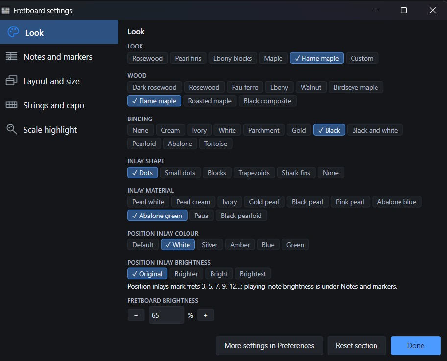
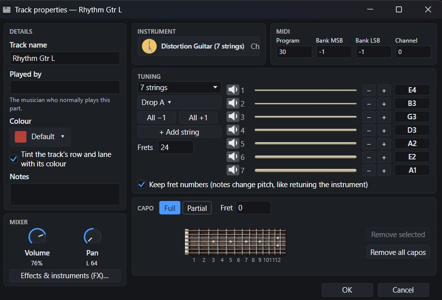
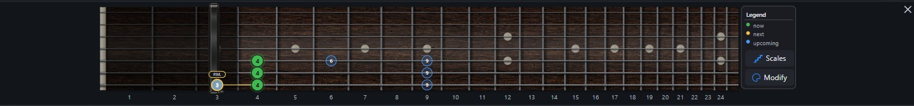

# TabForge 0.8.8

Stable release. It contains everything in 0.8.75, plus the fixes below.

## 🎸 New since 0.8.6

- **A more lifelike fretboard:** layered wood, true fret spacing, shaded binding, wound strings, material inlays and five looks, including Flame maple. Tune brightness and scale highlighting in the fretboard settings.
- **Full and partial capos:** add and drag capos on the fretboard or in Track properties. Up to four partial capos can cover different strings; notes, playback and score labels follow the effective capo.
- **More flexible tuning and track setup:** presets for 3–10 strings, saved custom tunings, per-string audition and compact Details, Mixer and MIDI cards. Track changes remain a draft until you choose OK.
- **Plug-in workflow:** 32-bit VST2 plug-ins use a helper process; bridged VST3 plug-ins can open their own editor. Approve all or selected plug-ins with visible progress and Stop.
- **Linux packages (experimental):** AppImage is primary; the `.tar.gz` is a fallback. Both include pinned Wine and an LGPL FFmpeg build for video export.

| 📷 Fretboard settings | 🎼 Track properties and tuning |
| :---: | :---: |
|  |  |

| 🎸 Partial capo on the fretboard |
| :---: |
|  |

## 🛠️ Fixes and performance

- The FX chain window now displays correctly with display scaling, and the Load FX Chain dialogue is fixed.
- File > Open no longer waits in a nested message loop; slow starting folders are checked off the UI thread with a timeout, and repeated Ctrl+O requests cannot overlap.
- Playback playheads follow display frames. Track-meter menus stay focused on meter controls, scale tooltips remain anchored, and reapplying the recommended UI size is a no-op.
- Plug-in search, piano-roll note queries, marker drawing, path retention, hidden-editor polling, icon preparation and General MIDI bank replacement avoid repeated or audio-thread work.
- Track-property edits stay transactional until OK; tuning changes warn before notes become unplayable. Container Active on rules apply consistently and survive preset loading.
- Projects with absolute plug-in paths from another operating system open with a readable missing-plug-in notice instead of refusing the project.

Automatic scale detection and best-match suggestions continue to work across the status bar, fretboard and piano roll; that capability first shipped in 0.8.6 and is not counted as new here.

Windows installers are not code-signed. Linux has not been validated on real hardware and remains experimental. Some JUCE 8 plug-in editors can render black under Wine; eight bridged plug-ins may need 1,024-frame buffers. A faulty native 64-bit VST2 plug-in can still crash the Windows audio engine. See the [complete changelog](https://github.com/cobhc95/TabForge/blob/v0.8.8/docs/CHANGELOG.md) for all changes since 0.8.6 and the [compatibility notes](https://github.com/cobhc95/TabForge/blob/v0.8.8/docs/README.md).
