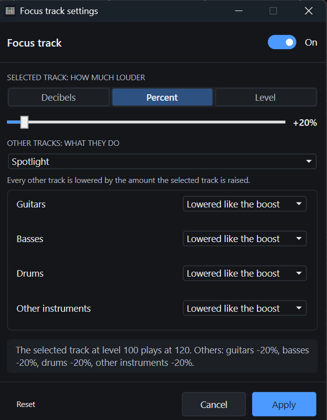

# TabForge 0.9.5

Stable release. It adds Focus track, an opt-in practice aid that plays the selected track louder, gives every slider and switch the app's accent colour, and fixes plug-in loading and GM sound problems.

## 🎸 New since 0.9.4

- **Focus track:** a left strip icon (and View > Focus track) that plays the selected track louder so it is easy to hear against the rest. Off until you turn it on; once on, it stays on until you turn it off. Left-click turns it on or off; right-click opens its settings.
- **How much louder:** 20% to begin with, or choose decibels, a percentage or a fixed level, with a slider.
- **What the other tracks do:** lowered by the same amount by default, group by group (guitars, basses, drums, other instruments): lowered like the boost, left exactly as they are, or lowered or raised by an amount of their own. Four templates fill the groups at once: Spotlight, Keep the rhythm section, Only boost the selected track and Rhythm section up.
- **Safe by design:** the selected track is never lowered, and Focus track changes only what you hear. Faders, the saved song, exports and renders are never touched.
- **Accent sliders and switches:** every slider fills with the accent colour up to its thumb, as the mixer faders do, and every On/Off switch uses the accent colour while on.

| 🎛️ Focus track settings |
| :-- |
|  |

## 🛠️ Fixes and performance

- **GM sound after reopen:** the automatic GM sound tick and a manual GM untick are now saved in the song. Reopening a song with a playing VST instrument (such as Superior Drummer) switches the built-in GM sound off as it does when you add the instrument.
- **Composer grooves on Linux:** auditioning a groove always plays the built-in drum kit, never the sound of the track on the drum channel (channel 10).
- **Plug-in loading:** Windows no longer says a plug-in "could not be loaded under Wine"; it shows the plug-in's own reason. VST2 plug-ins whose support files are found through the system PATH now load, and older VST2 plug-ins that only use the original process call load instead of being refused.
- **Plug-in editors and presets:** small plug-in editors keep the size the plug-in asked for, and preset switching now works for 32-bit VST2 plug-ins.

Windows installers are not code-signed. Linux has not been validated on real hardware and remains experimental. Some JUCE 8 plug-in editors can render black under Wine; eight bridged plug-ins may need 1,024-frame buffers. A faulty native 64-bit VST2 plug-in can still crash the Windows audio engine.

[Complete changelog](https://github.com/cobhc95/TabForge/blob/main/docs/CHANGELOG.md#095) · [Compatibility notes](https://github.com/cobhc95/TabForge/blob/v0.9.5/docs/README.md#plug-ins)
